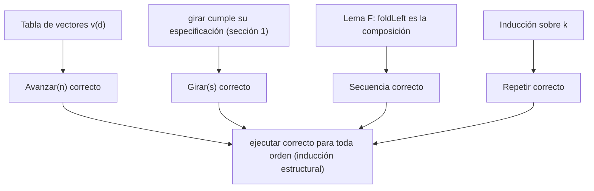

# Informe de corrección:
---

## 0. Notación para puntos 1 y 2.

**Direcciones.** Se numeran en el sentido de las manecillas del reloj:

$$\theta(N)=0, \quad \theta(E)=1, \quad \theta(S)=2, \quad \theta(O)=3$$

$\theta$ es una biyección entre las cuatro direcciones y $\mathbb{Z}_4$, así que se puede trabajar con aritmética módulo 4.

**Vector de avance.** Cada dirección tiene un vector unitario que dice hacia dónde se mueve el robot al avanzar una casilla:

$$v(N)=(0,1), \quad v(E)=(1,0), \quad v(S)=(0,-1), \quad v(O)=(-1,0)$$

Esto sale del enunciado: avanzar al norte aumenta $y$ y avanzar al este aumenta $x$.

**Estados.** Un estado es una tripleta $e=(x,y,d)$. El estado inicial es $(0,0,N)$.

**Significado de una orden.** $\mathrm{ej}(o,e)$ es el estado que resulta de ejecutar la orden $o$ desde el estado $e$. Para cada orden $o$ se escribe también $f_o(e)=\mathrm{ej}(o,e)$ cuando se la ve como función de estados.

**Potencia de una función.** Para una función $f$ sobre estados:

$$f^{0}=\mathrm{Id}, \qquad f^{k}=f^{k-1}\circ f \;\; (k\ge 1)$$

Es decir, $f^{k}$ aplica $f$ exactamente $k$ veces.

---

## 1. Punto 1: `girar`

### 1.1 Qué pide el enunciado

Girar noventa grados a la derecha o a la izquierda, sin moverse. Con la numeración de arriba, un giro a la derecha avanza un lugar en el reloj y uno a la izquierda retrocede un lugar. La especificación es:

$$\theta(\texttt{girar}(d, \texttt{Derecha})) = (\theta(d)+1) \bmod 4$$

$$\theta(\texttt{girar}(d, \texttt{Izquierda})) = (\theta(d)+3) \bmod 4$$

(Sumar 3 módulo 4 equivale a restar 1.)

### 1.2 El código cumple la especificación

El código tiene un caso por cada pareja $(d,s)$. Hay $4\times 2=8$ parejas y el código tiene 8 casos, todos distintos. Se verifica cada uno contra la fórmula:

| $d$ | $\theta(d)$ | Sentido | Fórmula | Resultado esperado | Código devuelve |
|---|---|---|---|---|---|
| Norte | 0 | Derecha | $(0+1) \bmod 4 = 1$ | Este | Este ✓ |
| Este | 1 | Derecha | $(1+1) \bmod 4 = 2$ | Sur | Sur ✓ |
| Sur | 2 | Derecha | $(2+1) \bmod 4 = 3$ | Oeste | Oeste ✓ |
| Oeste | 3 | Derecha | $(3+1) \bmod 4 = 0$ | Norte | Norte ✓ |
| Norte | 0 | Izquierda | $(0+3) \bmod 4 = 3$ | Oeste | Oeste ✓ |
| Oeste | 3 | Izquierda | $(3+3) \bmod 4 = 2$ | Sur | Sur ✓ |
| Sur | 2 | Izquierda | $(2+3) \bmod 4 = 1$ | Este | Este ✓ |
| Este | 1 | Izquierda | $(1+3) \bmod 4 = 0$ | Norte | Norte ✓ |

**Totalidad.** `Direccion` y `Sentido` son `sealed`, así que sus únicos valores son los 4 y los 2 declarados. Los 8 casos cubren todas las parejas posibles, por lo que `girar` está definida para toda entrada y nunca falla con un `MatchError`.

**Determinismo.** Ninguna pareja aparece dos veces, así que para cada entrada coincide un único caso.

### 1.3 Propiedades que se derivan

Como `girar` cumple la fórmula, se obtienen dos propiedades útiles para el punto 2.

**Propiedad G1: cuatro giros iguales vuelven a la dirección original.** Para todo $d$:

$$\theta\big(\texttt{girar}^{4}(d,\texttt{Derecha})\big) = (\theta(d)+4) \bmod 4 = \theta(d)$$

Como $\theta$ es biyección, la dirección resultante es $d$.

**Propiedad G2: girar a la derecha y luego a la izquierda se cancela.** Para todo $d$:

$$\theta(\texttt{girar}(\texttt{girar}(d,\texttt{Derecha}),\texttt{Izquierda})) = ((\theta(d)+1)+3) \bmod 4 = \theta(d)$$

---

## 2. Punto 2: `ejecutar`

### 2.1 Qué pide el enunciado: la especificación

El enunciado describe qué hace cada orden. Traducido a matemáticas, con $e=(x,y,d)$:

**(E1) Avanzar.** Se mueve $n$ casillas en la dirección a la que mira, y con $n$ negativo retrocede:

$$\mathrm{ej}(\texttt{Avanzar}(n),\,(x,y,d)) = (x + n\,v_x(d),\; y + n\,v_y(d),\; d)$$

**(E2) Girar.** Cambia la dirección sin moverse:

$$\mathrm{ej}(\texttt{Girar}(s),\,(x,y,d)) = (x,\,y,\,\texttt{girar}(d,s))$$

**(E3) Repetir.** Ejecuta la orden tantas veces como se indique; con cero o menos veces no hace nada:

$$\mathrm{ej}(\texttt{Repetir}(k,o),\,e) = \begin{cases} e & \text{si } k \le 0 \\ (f_o)^{k}(e) & \text{si } k > 0 \end{cases}$$

**(E4) Secuencia.** Ejecuta en orden la lista de órdenes; la lista vacía no hace nada:

$$\mathrm{ej}(\texttt{Secuencia}(o_1,\dots,o_m),\,e) = (f_{o_m}\circ\cdots\circ f_{o_1})(e)$$

con $m=0$ dando la identidad.

### 2.2 Terminación

Se define el tamaño de una orden:

$$\mathrm{tam}(\texttt{Avanzar}(n))=\mathrm{tam}(\texttt{Girar}(s))=1$$

$$\mathrm{tam}(\texttt{Repetir}(k,o))=1+\mathrm{tam}(o)$$

$$\mathrm{tam}(\texttt{Secuencia}(os))=1+\textstyle\sum_{o'\in os}\mathrm{tam}(o')$$

Cada llamada recursiva de `ejecutar` es sobre algo estrictamente más pequeño según el orden lexicográfico de la pareja $(\mathrm{tam}(o),\; \max(k,0))$:

- En `Secuencia`, `ejecutar` se llama sobre cada elemento de la lista, cuyo tamaño es menor que el de la secuencia.
- En `Repetir(veces, orden)`, la llamada `ejecutar(e, orden)` es sobre una orden de menor tamaño.
- En `Repetir(veces, orden)`, la llamada `ejecutar(_, Repetir(veces - 1, orden))` conserva el tamaño pero reduce $k$ en 1, y el caso `veces <= 0` detiene la recursión.

Como ese orden es bien fundado, toda llamada termina.

### 2.3 Demostración de corrección

Se demuestra que para toda orden $o$ y todo estado $e$, el valor que devuelve `ejecutar(e, o)` es el que dice la especificación. La prueba es por **inducción estructural sobre $o$**: hay un caso por cada alternativa de `Orden`, igual que en el código.

#### Caso `Avanzar(n)` (caso base)

El código hace `match` sobre `e.mira`:

| `e.mira` | Código | $v(d)$ | Fórmula E1 |
|---|---|---|---|
| Norte | $y \leftarrow y+n$ | $(0,1)$ | $(x+0,\; y+n)$ ✓ |
| Sur | $y \leftarrow y-n$ | $(0,-1)$ | $(x+0,\; y-n)$ ✓ |
| Este | $x \leftarrow x+n$ | $(1,0)$ | $(x+n,\; y+0)$ ✓ |
| Oeste | $x \leftarrow x-n$ | $(-1,0)$ | $(x-n,\; y+0)$ ✓ |

En todos los casos el resultado coincide con (E1), y `copy` conserva la dirección. Como la fórmula es válida para cualquier entero $n$, el caso negativo ya está cubierto: $n<0$ desplaza en sentido contrario al que mira el robot, es decir, retrocede.

#### Caso `Girar(s)` (caso base)

El código devuelve `e.copy(mira = girar(e.mira, s))`: cambia únicamente la dirección y deja $(x,y)$ intactos. Es exactamente (E2), y es correcto porque `girar` lo es (sección 1).

#### Caso `Secuencia(ordenes)`

Primero se establece cómo trabaja `foldLeft`:

$$\texttt{Nil.foldLeft}(z)(g) = z \qquad\qquad (a::as)\texttt{.foldLeft}(z)(g) = as\texttt{.foldLeft}(g(z,a))(g)$$

**Lema F.** Para toda lista $os=[o_1,\dots,o_m]$ cuyas órdenes cumplen la hipótesis de inducción:

$$os\texttt{.foldLeft}(e)(\mathrm{ej}) = (f_{o_m}\circ\cdots\circ f_{o_1})(e)$$

*Demostración, por inducción sobre la longitud $m$.*

- Si $m=0$: `Nil.foldLeft(e)(ej)` $=e$, que es la composición vacía (identidad).
- Si $m>0$: $(o_1::os')$`.foldLeft(e)(ej)` $= os'$`.foldLeft(ej(e,`$o_1$`))(ej)`. Por hipótesis de inducción sobre la longitud, esto es $(f_{o_m}\circ\cdots\circ f_{o_2})(f_{o_1}(e))$, que es $(f_{o_m}\circ\cdots\circ f_{o_1})(e)$.

Con el lema, `Secuencia` cumple (E4): el estado que se pasa de una orden a la siguiente es el resultado de la anterior. Con la lista vacía devuelve $e$.

#### Caso `Repetir(veces, orden)`

Sea $f=f_{o}$, con $o=$`orden`. Por hipótesis de inducción, `ejecutar(_, orden)` implementa $f$ correctamente.

- Si $k\le 0$, la guarda devuelve $e$. (primer caso de E3)
- Si $k>0$, se prueba por inducción sobre $k$ que `ejecutar(e, Repetir(k, o))` $=f^{k}(e)$:
  - Para $k=1$: el código evalúa `ejecutar(ejecutar(e, o), Repetir(0, o))` $=\mathrm{ej}(\texttt{Repetir}(0,o),\,f(e)) = f(e) = f^{1}(e)$.
  - Para $k>1$: el código evalúa `ejecutar(ejecutar(e, o), Repetir(k-1, o))` $=\mathrm{ej}(\texttt{Repetir}(k-1,o),\,f(e))$. Por hipótesis de inducción sobre $k$, esto es $f^{k-1}(f(e)) = (f^{k-1}\circ f)(e) = f^{k}(e)$.

Con esto se cubren las cuatro alternativas de `Orden`, y por inducción estructural `ejecutar` cumple la especificación para toda orden y todo estado.



---

### 2.4. Las rutinas compuestas equivalen a ejecutar sus partes

El punto 2 dice que `Repetir` y `Secuencia` son órdenes que contienen otras órdenes. La corrección anterior ya implica que ejecutar la orden compuesta es lo mismo que ejecutar sus componentes. Se formaliza en tres resultados.

**Teorema 1 (secuencia de dos órdenes).** Para todo $e$:

$$\mathrm{ej}(\texttt{Secuencia}(o_1,o_2),\,e) = \mathrm{ej}(o_2,\,\mathrm{ej}(o_1,\,e))$$

*Demostración.* Es (E4) con $m=2$: $(f_{o_2}\circ f_{o_1})(e)$. $\blacksquare$

**Teorema 2 (concatenación de secuencias).** Para todo $e$:

$$\mathrm{ej}(\texttt{Secuencia}(os_1 \mathbin{+\!\!+} os_2),\,e) = \mathrm{ej}(\texttt{Secuencia}(os_2),\,\mathrm{ej}(\texttt{Secuencia}(os_1),\,e))$$

*Demostración.* Si $os_1=[a_1,\dots,a_p]$ y $os_2=[b_1,\dots,b_q]$, por (E4) el lado izquierdo es $(f_{b_q}\circ\cdots\circ f_{b_1}\circ f_{a_p}\circ\cdots\circ f_{a_1})(e)$, que es la composición $(f_{b_q}\circ\cdots\circ f_{b_1})\big((f_{a_p}\circ\cdots\circ f_{a_1})(e)\big)$, el lado derecho. $\blacksquare$

**Teorema 3 (repetir equivale a la secuencia de copias).** Para todo $k\ge 0$ y todo $e$:

$$\mathrm{ej}(\texttt{Repetir}(k,o),\,e) = \mathrm{ej}(\texttt{Secuencia}(\underbrace{o,\dots,o}_{k}),\,e)$$

*Demostración.* Por (E3) el lado izquierdo es $f_o^{k}(e)$ (con $k=0$ da $e$). Por (E4) el derecho es $(f_o\circ\cdots\circ f_o)(e)$ con $k$ factores, que es también $f_o^{k}(e)$. $\blacksquare$

---

### 2.5. Verificación con los ejemplos del enunciado

| Llamada | Razonamiento | Resultado |
|---|---|---|
| `ejecutar(inicial, Avanzar(3))` | E1 con $d=N$: $(0+0,\;0+3)$ | $(0,3,N)$ ✓ |
| `ejecutar(inicial, Avanzar(-2))` | E1 con $d=N$, $n=-2$: $(0,\;0-2)$ | $(0,-2,N)$ ✓ |
| `ejecutar(inicial, Repetir(0, Avanzar(5)))` | E3 con $k=0\le 0$ | $(0,0,N)$ ✓ |
| `ejecutar(inicial, Secuencia(Nil))` | E4 con $m=0$ | $(0,0,N)$ ✓ |
| `Secuencia(Avanzar(2), Girar(Derecha), Avanzar(4))` | Teorema 1 dos veces: $(0,2,N)\to(0,2,E)\to(4,2,E)$ | $(4,2,E)$ ✓ |

### El cuadrado vuelve al punto de partida (para cualquier estado)

El enunciado destaca que `cuadrado` $=$ `Repetir(4, c)`, con `c = Secuencia(Avanzar(1), Girar(Derecha))`, deja al robot donde empezó. Se prueba para **todo** estado inicial, no solo el origen.

**Paso 1: efecto de una vuelta.** Por el Teorema 1, (E1) y (E2), para $e=(x,y,d)$:

$$f_c(x,y,d) = (x+v_x(d),\; y+v_y(d),\; d')\quad\text{con}\quad \theta(d')=(\theta(d)+1) \bmod 4$$

**Paso 2: efecto de $j$ vueltas.** Por inducción sobre $j$:

$$f_c^{\,j}(x,y,d) = \Big(x+\sum_{i=0}^{j-1} v_x(d_i),\;\; y+\sum_{i=0}^{j-1} v_y(d_i),\;\; d_j\Big),\qquad \theta(d_i)=(\theta(d)+i) \bmod 4$$

*Base* $j=0$: sumas vacías, resultado $(x,y,d)$. ✓
*Paso*: aplicar $f_c$ al estado de $j$ vueltas suma $v(d_j)$ y gira a $d_{j+1}$, con $\theta(d_{j+1})=(\theta(d)+j+1) \bmod 4$. ✓

**Paso 3: cuatro vueltas.** Las cuatro direcciones $d_0,d_1,d_2,d_3$ son una permutación de $\{N,E,S,O\}$, así que:

$$\sum_{i=0}^{3} v(d_i) = (0,1)+(1,0)+(0,-1)+(-1,0) = (0,0)$$

Además $\theta(d_4)=(\theta(d)+4) \bmod 4=\theta(d)$, o sea $d_4=d$ (propiedad G1). Por tanto:

$$\mathrm{ej}(\texttt{cuadrado},\,(x,y,d)) = (x,y,d)\quad\text{para todo estado}$$

En particular, desde `inicial` el resultado es $(0,0,N)$, como pide el enunciado. ✓

---

### 2.6. Cumplimiento de las restricciones del taller

| Restricción | Cumplimiento |
|---|---|
| `match` en lugar de condicionales encadenados | `girar` hace `match` sobre la pareja `(d, s)`. `ejecutar` hace `match` sobre `o` y sobre `e.mira`. |
| Sin variables mutables | Solo se usan `val` implícitos. `copy` crea estados nuevos y no modifica el original. |
| Sin ciclos `for` o `while` | La repetición se resuelve con recursión (`Repetir`) y con `foldLeft` (`Secuencia`). |
| Sin `return` | Cada rama del `match` es una expresión cuyo valor es el resultado. |
| Modelo de datos sin modificar | Se usan los tipos entregados tal cual. |

# Informe de corrección: punto 3 (contar órdenes)

## 0. Notación

### 0.1. Órdenes

Sea $\mathcal{O}$ el conjunto de todas las órdenes del robot. Según el modelo de datos, las órdenes se construyen mediante cuatro alternativas:

- $\operatorname{Avanzar}(n)$, donde $n\in\mathbb{Z}$.
- $\operatorname{Girar}(s)$, donde $s$ representa el sentido del giro.
- $\operatorname{Secuencia}(L)$, donde $L$ es una lista de órdenes.
- $\operatorname{Repetir}(k,o)$, donde $k$ es el número de repeticiones y \(o\) es una orden.

Se consideran básicas las órdenes $\operatorname{Avanzar}(n)$ y $\operatorname{Girar}(s)$. Las otras dos son compuestas porque contienen listas u órdenes.

### 0.2. Funciones que se deben implementar

El punto 3 solicita dos funciones que analizan una orden sin ejecutarla:

$
B:\mathcal{O}\rightarrow\mathbb{N}
$

$
P:\mathcal{O}\rightarrow\mathbb{N}
$

Donde:

- $B(o)$ representa la cantidad de órdenes básicas que se ejecutarían al ejecutar $o$, contando las repeticiones.
- $P(o)$ representa la profundidad de anidamiento de $o$.

En el código, estas funciones se denominan `cuantasBasicas` y `profundidad`, respectivamente.

## 1. Punto 3.1: función `cuantasBasicas`

### 1.1. Qué pide el enunciado

La función debe contar cuántas órdenes básicas contiene una orden y cuántas veces se ejecutarían. No debe mover el robot ni modificar su estado.

La especificación matemática se define recursivamente:

**(B1) Avanzar.** Toda orden `Avanzar` cuenta como una orden básica, independientemente de la distancia:

$
B(\operatorname{Avanzar}(n))=1
$

**(B2) Girar.** Toda orden `Girar` cuenta como una orden básica:

$
B(\operatorname{Girar}(s))=1
$

**(B3) Secuencia.** Se suman las cantidades correspondientes a todas las órdenes de la lista:

$
B(\operatorname{Secuencia}(L))
=\sum_{o\in L}B(o)
$

Si la lista está vacía, la suma es cero:

$
B(\operatorname{Secuencia}([]))=0
$

**(B4) Repetir.** Si el número de repeticiones es positivo, se multiplica la cantidad de órdenes básicas de la orden interna por el número de repeticiones. Si es cero o negativo, no se ejecuta ninguna orden:

$
B(\operatorname{Repetir}(k,o))=
\begin{cases}
0 & \text{si }k\leq 0\\
k\cdot B(o) & \text{si }k>0
\end{cases}
$

Estas cuatro reglas definen el comportamiento esperado de `cuantasBasicas`.

### 1.2. El código cumple la especificación

La implementación recursiva correspondiente es:

```scala
def cuantasBasicas(o: Orden): Int = o match {
  case Avanzar(_) => 1
  case Girar(_) => 1

  case Secuencia(ordenes) =>
    ordenes.map(cuantasBasicas).sum

  case Repetir(k, _) if k <= 0 =>
    0

  case Repetir(k, orden) =>
    k * cuantasBasicas(orden)
}
```

Cada caso coincide con la regla matemática correspondiente.

| Caso | Operación del código | Especificación |
|---|---|---|
| `Avanzar(n)` | Devuelve `1` | (B1) |
| `Girar(s)` | Devuelve `1` | (B2) |
| `Secuencia(L)` | Suma los resultados de cada orden | (B3) |
| `Repetir(k, o)`, \(k\leq 0\) | Devuelve `0` | (B4) |
| `Repetir(k, o)`, \(k>0\) | Multiplica \(k\) por el resultado de la orden interna | (B4) |

**Totalidad.** Como `Orden` es un tipo algebraico con cuatro alternativas, el `match` contempla todos sus constructores. Las dos alternativas de `Repetir` se distinguen mediante la condición sobre \(k\), por lo que también quedan cubiertos todos los valores de repetición.

**Determinismo.** Para cada orden existe un único resultado definido por las reglas anteriores. No se modifican las órdenes ni se ejecutan sus movimientos.

### 1.3. Propiedades que se derivan

**Propiedad B1: las órdenes básicas siempre cuentan uno.**

Para cualquier entero $n$ y cualquier sentido $s$:

$
B(\operatorname{Avanzar}(n))=
B(\operatorname{Girar}(s))=1
$

La distancia de avance no modifica el conteo, porque se cuenta la orden y no el número de casillas recorridas.

**Propiedad B2: las secuencias son aditivas.**

Para dos listas de órdenes $L_1$ y $L_2$, su concatenación satisface:


$B(\operatorname{Secuencia}(L_1\mathbin{+\!\!+}L_2))
=B(\operatorname{Secuencia}(L_1))+
B(\operatorname{Secuencia}(L_2))$


Esto se deriva de que la suma de los elementos de una concatenación es la suma de las dos listas.

**Propiedad B3: las repeticiones multiplican el conteo.**

Para $k>0$:

$
B(\operatorname{Repetir}(k,o))=kB(o)
$

En particular, repetir dos veces una orden con tres órdenes básicas produce un total de seis.

## 2. Punto 3.2: función `profundidad`

### 2.1. Qué pide el enunciado

La función debe calcular los niveles de anidamiento de una orden, sin ejecutarla.

Una orden básica tiene profundidad $1$. Una orden compuesta tiene una profundidad igual a uno más que la profundidad máxima de las órdenes que contiene.

La especificación es la siguiente.

**(P1) Avanzar.**

$
P(\operatorname{Avanzar}(n))=1
$

**(P2) Girar.**

$
P(\operatorname{Girar}(s))=1
$

**(P3) Secuencia.** Si la secuencia contiene órdenes, su profundidad es uno más que la profundidad máxima de sus elementos:

$
P(\operatorname{Secuencia}(L))
=1+\max_{o\in L}P(o)
$

Para una secuencia vacía, el enunciado establece explícitamente:

$
P(\operatorname{Secuencia}([]))=1
$

Esta excepción evita calcular el máximo de una lista vacía, operación que no está definida.

**(P4) Repetir.** La repetición agrega un nivel de anidamiento a la orden que contiene:

$
P(\operatorname{Repetir}(k,o))=1+P(o)
$

Esta regla se aplica independientemente de la cantidad de repeticiones. La profundidad mide la estructura de la orden, no el número de veces que se ejecuta.

### 2.2. El código cumple la especificación

La implementación correspondiente es:

```scala
def profundidad(o: Orden): Int = o match {
  case Avanzar(_) => 1
  case Girar(_) => 1

  case Secuencia(ordenes) =>
    if (ordenes.isEmpty) 1
    else 1 + ordenes.map(profundidad).max

  case Repetir(_, orden) =>
    1 + profundidad(orden)
}
```

Cada alternativa coincide con su regla matemática.

| Caso | Operación del código | Especificación |
|---|---|---|
| `Avanzar(n)` | Devuelve `1` | (P1) |
| `Girar(s)` | Devuelve `1` | (P2) |
| `Secuencia(Nil)` | Devuelve `1` | (P3), caso vacío |
| `Secuencia(L)` no vacía | Calcula el máximo y suma uno | (P3) |
| `Repetir(k, o)` | Calcula la profundidad interna y suma uno | (P4) |

**Totalidad.** Se contemplan todos los constructores de `Orden`. Además, la secuencia vacía se trata antes de calcular el máximo, evitando un error al evaluar `max` sobre una lista vacía.

**Determinismo.** La profundidad queda determinada por la estructura de la orden. Si las ramas tienen distintas profundidades, se selecciona la mayor, tal como exige el enunciado.

### 2.3. Propiedades que se derivan

**Propiedad P1: las órdenes básicas tienen profundidad uno.**

$
P(\operatorname{Avanzar}(n))
=P(\operatorname{Girar}(s))=1
$

**Propiedad P2: cada nivel compuesto agrega uno.**

Para cualquier orden $o$:

$
P(\operatorname{Repetir}(k,o))=1+P(o)
$

Por ejemplo:

$
P(\operatorname{Repetir}(3,\operatorname{Avanzar}(1)))=2
$

Aunque la orden se repita tres veces, el anidamiento solamente agrega un nivel.

**Propiedad P3: la rama más profunda determina la profundidad de una secuencia.**

Si una secuencia contiene una orden de profundidad $2$ y otra de profundidad $4$, su profundidad es:

$
P(\operatorname{Secuencia}(L))=1+4=5
$

Las órdenes menos profundas no afectan el máximo.

**Propiedad P4: una secuencia vacía tiene profundidad uno.**

$
P(\operatorname{Secuencia}([]))=1
$

Este resultado es una condición expresa del enunciado, aunque no existan órdenes dentro de la secuencia.

## 3. Demostración de terminación

Se debe demostrar que las funciones finalizan para toda orden válida.

### 3.1. Terminación de `cuantasBasicas`

Se utiliza inducción estructural sobre las órdenes.

- **Casos básicos:** `Avanzar(n)` y `Girar(s)` devuelven directamente `1`, sin llamadas recursivas.
- **Caso `Secuencia(L)`:** la función se aplica a las órdenes que contiene la lista. Cada una es una subestructura de la orden original. Como la lista es finita y cada llamada termina, `map` y `sum` finalizan.
- **Caso `Repetir(k, o)`:** si $k\leq 0$, se devuelve directamente `0`. Si $k>0$, se realiza una única llamada recursiva sobre $o$, que es una subestructura de la orden original. No se efectúa una llamada recursiva por cada repetición.

Por inducción estructural, `cuantasBasicas` termina para toda orden finita.

### 3.2. Terminación de `profundidad`

También se utiliza inducción estructural.

- **Casos básicos:** `Avanzar(n)` y `Girar(s)` devuelven `1`.
- **Caso `Secuencia(L)`:** si la lista está vacía, se devuelve `1`. En caso contrario, se calcula la profundidad de cada elemento de una lista finita. Todas las llamadas recursivas corresponden a subórdenes más pequeñas.
- **Caso `Repetir(k, o)`:** se calcula la profundidad de la orden interna y se suma uno. La llamada recursiva se realiza sobre una suborden más pequeña.

En todos los casos, la recursión avanza hacia subestructuras estrictamente menores. Por inducción estructural, `profundidad` termina para toda orden finita.

## 4. Demostración de corrección

Se demuestra que las dos funciones cumplen sus respectivas especificaciones mediante inducción estructural sobre la orden \(o\).

### 4.1. Corrección de `cuantasBasicas`

Se quiere demostrar que el valor devuelto por `cuantasBasicas(o)` es igual a $B(o$).

**Caso `Avanzar(n)`.** El código devuelve `1`, que coincide con (B1).

$
\operatorname{cuantasBasicas}(\operatorname{Avanzar}(n))=1=B(\operatorname{Avanzar}(n))
$

**Caso `Girar(s)`.** El código devuelve `1`, que coincide con (B2).

$
\operatorname{cuantasBasicas}(\operatorname{Girar}(s))=1=B(\operatorname{Girar}(s))
$

**Caso `Secuencia(L)`.** Por hipótesis de inducción, para cada orden $o_i$ de la lista, la llamada recursiva devuelve $B(o_i)$. Por tanto, la suma calculada por `map(...).sum` es:

$
\sum_{o_i\in L}B(o_i)
$

Este valor coincide con (B3). Si $L=[]$, la suma es cero, como establece la especificación.

**Caso `Repetir(k, o)`.**

Si $k\leq0$, el código devuelve cero, coincidiendo con (B4).

Si $k>0$, por hipótesis de inducción, la llamada `cuantasBasicas(o)` devuelve $B(o)$. El código multiplica este valor por $k$:

$
k\cdot\operatorname{cuantasBasicas}(o)
=k\cdot B(o)
$

Este es exactamente el resultado definido en (B4).

Se han demostrado los cuatro casos. Por inducción estructural, `cuantasBasicas` es correcta para toda orden.

### 4.2. Corrección de `profundidad`

Se quiere demostrar que el valor devuelto por `profundidad(o)` es igual a $P(o)$.

**Caso `Avanzar(n)`.** El código devuelve `1`, coincidiendo con (P1).

**Caso `Girar(s)`.** El código devuelve `1`, coincidiendo con (P2).

**Caso `Secuencia(L)`.**

Si $L=[]$, el código devuelve `1`, como establece expresamente (P3).

Si $L\neq[]$, por hipótesis de inducción, cada llamada recursiva devuelve la profundidad correcta de su orden. En consecuencia:

$
1+\max_{o_i\in L}\operatorname{profundidad}(o_i)
=
1+\max_{o_i\in L}P(o_i)
$

El resultado coincide con (P3).

**Caso `Repetir(k, o)`.** Por hipótesis de inducción, `profundidad(o)` devuelve $P(o)$. El código suma uno:

$
1+\operatorname{profundidad}(o)=1+P(o)
$

El resultado coincide con (P4), independientemente del valor de $k$.

Como se han cubierto todos los constructores, por inducción estructural `profundidad` es correcta para toda orden.

## 5. Verificación con los ejemplos del enunciado

Se verifica el comportamiento de las funciones con las entradas indicadas.

| Llamada | Razonamiento | Resultado |
|---|---|---:|
| `cuantasBasicas(Avanzar(3))` | Una orden básica | \(1\) |
| `cuantasBasicas(cuadrado)` | Cuatro repeticiones de dos órdenes básicas | \(8\) |
| `cuantasBasicas(Repetir(0, cuadrado))` | Cero repeticiones | \(0\) |
| `cuantasBasicas(Secuencia(Nil))` | Suma vacía | \(0\) |
| `profundidad(Avanzar(3))` | Orden básica | \(1\) |
| `profundidad(Secuencia(List(Avanzar(1), Girar(Derecha))))` | Una secuencia que contiene órdenes de profundidad \(1\) | \(2\) |
| `profundidad(cuadrado)` | Repetición, secuencia y órdenes básicas | \(3\) |
| `profundidad(Secuencia(Nil))` | Caso vacío definido por el enunciado | \(1\) |
| `profundidad(Secuencia(List(Avanzar(1), cuadrado)))` | La rama más profunda tiene profundidad \(3\) | \(4\) |

### 5.1. Análisis del cuadrado

El enunciado define:

$
c=\operatorname{Secuencia}(
[\operatorname{Avanzar}(1),\operatorname{Girar}(\operatorname{Derecha})])
$

$
\operatorname{cuadrado}=\operatorname{Repetir}(4,c)
$

Para contar las órdenes básicas, primero se calcula:

$
B(c)=B(\operatorname{Avanzar}(1))
+B(\operatorname{Girar}(\operatorname{Derecha}))
$

$
B(c)=1+1=2
$

Como el cuadrado repite esta secuencia cuatro veces:

$
B(\operatorname{cuadrado})=4\cdot2=8
$

Para calcular la profundidad:

$
P(c)=1+\max(1,1)=2
$

La repetición agrega otro nivel:

$
P(\operatorname{cuadrado})=1+P(c)=3
$

Por tanto, los resultados son ocho órdenes básicas y profundidad tres, como exige el enunciado.

## 6. Cumplimiento de las restricciones del taller

| Restricción | Cumplimiento |
|---|---|
| Uso de `match` | Se utiliza el patrón de coincidencia para distinguir los constructores de `Orden`. |
| Sin variables mutables | No se utiliza `var` ni se modifica ningún dato. |
| Sin ciclos `for` o `while` | Se utiliza recursión estructural y las operaciones funcionales `map`, `sum` y `max`. |
| Sin `return` | Cada rama del `match` produce directamente el resultado de la función. |
| Modelo de datos sin modificar | Se utilizan los constructores existentes: `Avanzar`, `Girar`, `Secuencia` y `Repetir`. |
| Sin ejecutar las órdenes | Las funciones inspeccionan la estructura de la orden y no modifican el estado del robot. |
| Tratamiento de casos límite | Se contemplan las secuencias vacías y las repeticiones con cantidad cero o negativa para el conteo. |

## 7. Conclusión

Las funciones `cuantasBasicas` y `profundidad` satisfacen la especificación del punto 3.

La primera cuenta las órdenes básicas que se ejecutarían, teniendo en cuenta las repeticiones y las secuencias vacías. La segunda calcula los niveles de anidamiento, considerando el nivel adicional de cada orden compuesta y seleccionando la rama más profunda de las secuencias.

La terminación se garantiza porque las llamadas recursivas se realizan sobre subestructuras finitas de la orden original. La corrección se demuestra por inducción estructural, comprobando cada constructor de `Orden` frente a su definición matemática.

Finalmente, ambas funciones respetan las restricciones del taller: no utilizan variables mutables, ciclos ni `return`, no modifican el modelo de datos y no ejecutan las órdenes que analizan.
