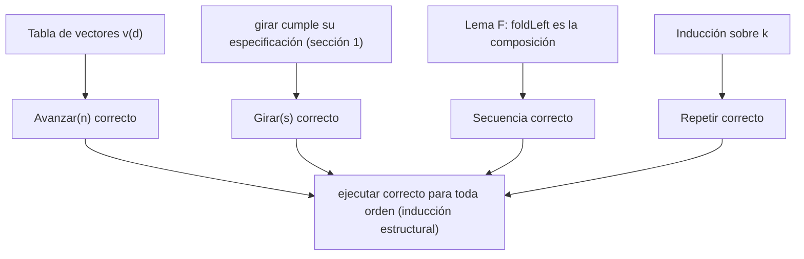
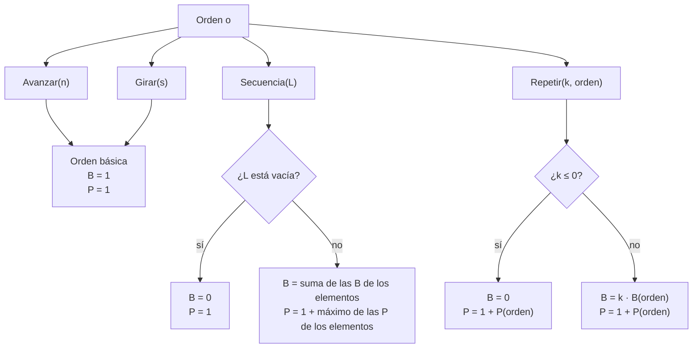
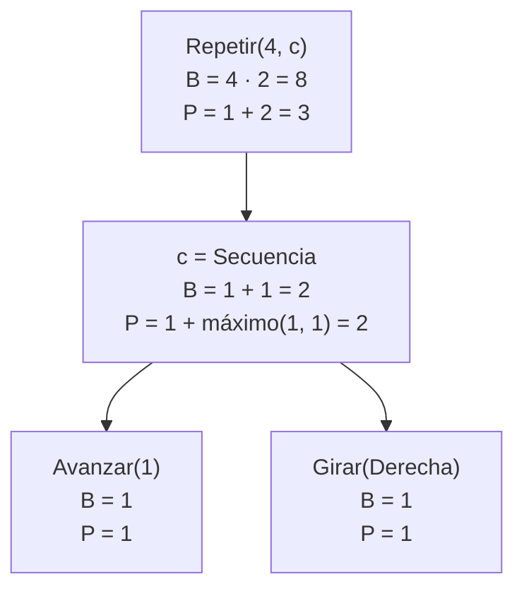

# Informe de corrección:
---

## 0. Notación para puntos 1 y 2.

**Direcciones.** Se numeran en el sentido de las manecillas del reloj:

$$\theta(N)=0, \quad \theta(E)=1, \quad \theta(S)=2, \quad \theta(O)=3$$

$\theta$ es una biyección entre las cuatro direcciones y $\mathbb{Z}_4$, así que se puede trabajar con aritmética módulo 4.

**Vector de avance.** Cada dirección tiene un vector unitario que dice hacia dónde se mueve el robot al avanzar una casilla:

$$v(N)=(0,1), \quad v(E)=(1,0), \quad v(S)=(0,-1), \quad v(O)=(-1,0)$$

Esto sale del enunciado: avanzar al norte aumenta $y$ y avanzar al este aumenta $x$.

**Estados.** Un estado es una tripleta $e=(x,y,d)$. El estado inicial es $(0,0,N)$.

**Significado de una orden.** $\mathrm{ej}(o,e)$ es el estado que resulta de ejecutar la orden $o$ desde el estado $e$. Para cada orden $o$ se escribe también $f_o(e)=\mathrm{ej}(o,e)$ cuando se la ve como función de estados.

**Potencia de una función.** Para una función $f$ sobre estados:

$$f^{0}=\mathrm{Id}, \qquad f^{k}=f^{k-1}\circ f \;\; (k\ge 1)$$

Es decir, $f^{k}$ aplica $f$ exactamente $k$ veces.

---

## 1. Punto 1: `girar`

### 1.1 Qué pide el enunciado

Girar noventa grados a la derecha o a la izquierda, sin moverse. Con la numeración de arriba, un giro a la derecha avanza un lugar en el reloj y uno a la izquierda retrocede un lugar. La especificación es:

$$\theta(\texttt{girar}(d, \texttt{Derecha})) = (\theta(d)+1) \bmod 4$$

$$\theta(\texttt{girar}(d, \texttt{Izquierda})) = (\theta(d)+3) \bmod 4$$

(Sumar 3 módulo 4 equivale a restar 1.)

### 1.2 El código cumple la especificación

El código tiene un caso por cada pareja $(d,s)$. Hay $4\times 2=8$ parejas y el código tiene 8 casos, todos distintos. Se verifica cada uno contra la fórmula:

| $d$ | $\theta(d)$ | Sentido | Fórmula | Resultado esperado | Código devuelve |
|---|---|---|---|---|---|
| Norte | 0 | Derecha | $(0+1) \bmod 4 = 1$ | Este | Este |
| Este | 1 | Derecha | $(1+1) \bmod 4 = 2$ | Sur | Sur |
| Sur | 2 | Derecha | $(2+1) \bmod 4 = 3$ | Oeste | Oeste |
| Oeste | 3 | Derecha | $(3+1) \bmod 4 = 0$ | Norte | Norte |
| Norte | 0 | Izquierda | $(0+3) \bmod 4 = 3$ | Oeste | Oeste |
| Oeste | 3 | Izquierda | $(3+3) \bmod 4 = 2$ | Sur | Sur |
| Sur | 2 | Izquierda | $(2+3) \bmod 4 = 1$ | Este | Este |
| Este | 1 | Izquierda | $(1+3) \bmod 4 = 0$ | Norte | Norte |

**Totalidad.** `Direccion` y `Sentido` son `sealed`, así que sus únicos valores son los 4 y los 2 declarados. Los 8 casos cubren todas las parejas posibles, por lo que `girar` está definida para toda entrada y nunca falla con un `MatchError`.

**Determinismo.** Ninguna pareja aparece dos veces, así que para cada entrada coincide un único caso.

### 1.3 Propiedades que se derivan

Como `girar` cumple la fórmula, se obtienen dos propiedades útiles para el punto 2.

**Propiedad G1: cuatro giros iguales vuelven a la dirección original.** Para todo $d$:

$$\theta\big(\texttt{girar}^{4}(d,\texttt{Derecha})\big) = (\theta(d)+4) \bmod 4 = \theta(d)$$

Como $\theta$ es biyección, la dirección resultante es $d$.

**Propiedad G2: girar a la derecha y luego a la izquierda se cancela.** Para todo $d$:

$$\theta(\texttt{girar}(\texttt{girar}(d,\texttt{Derecha}),\texttt{Izquierda})) = ((\theta(d)+1)+3) \bmod 4 = \theta(d)$$

---

## 2. Punto 2: `ejecutar`

### 2.1 Qué pide el enunciado: la especificación

El enunciado describe qué hace cada orden. Traducido a matemáticas, con $e=(x,y,d)$:

**(E1) Avanzar.** Se mueve $n$ casillas en la dirección a la que mira, y con $n$ negativo retrocede:

$$\mathrm{ej}(\texttt{Avanzar}(n),\,(x,y,d)) = (x + n\,v_x(d),\; y + n\,v_y(d),\; d)$$

**(E2) Girar.** Cambia la dirección sin moverse:

$$\mathrm{ej}(\texttt{Girar}(s),\,(x,y,d)) = (x,\,y,\,\texttt{girar}(d,s))$$

**(E3) Repetir.** Ejecuta la orden tantas veces como se indique; con cero o menos veces no hace nada:

$$\mathrm{ej}(\texttt{Repetir}(k,o),\,e) = \begin{cases} e & \text{si } k \le 0 \\ (f_o)^{k}(e) & \text{si } k > 0 \end{cases}$$

**(E4) Secuencia.** Ejecuta en orden la lista de órdenes; la lista vacía no hace nada:

$$\mathrm{ej}(\texttt{Secuencia}(o_1,\dots,o_m),\,e) = (f_{o_m}\circ\cdots\circ f_{o_1})(e)$$

con $m=0$ dando la identidad.

### 2.2 Terminación

Se define el tamaño de una orden:

$$\mathrm{tam}(\texttt{Avanzar}(n))=\mathrm{tam}(\texttt{Girar}(s))=1$$

$$\mathrm{tam}(\texttt{Repetir}(k,o))=1+\mathrm{tam}(o)$$

$$\mathrm{tam}(\texttt{Secuencia}(os))=1+\textstyle\sum_{o'\in os}\mathrm{tam}(o')$$

Cada llamada recursiva de `ejecutar` es sobre algo estrictamente más pequeño según el orden lexicográfico de la pareja $(\mathrm{tam}(o),\; \max(k,0))$:

- En `Secuencia`, `ejecutar` se llama sobre cada elemento de la lista, cuyo tamaño es menor que el de la secuencia.
- En `Repetir(veces, orden)`, la llamada `ejecutar(e, orden)` es sobre una orden de menor tamaño.
- En `Repetir(veces, orden)`, la llamada `ejecutar(_, Repetir(veces - 1, orden))` conserva el tamaño pero reduce $k$ en 1, y el caso `veces <= 0` detiene la recursión.

Como ese orden es bien fundado, toda llamada termina.

### 2.3 Demostración de corrección

Se demuestra que para toda orden $o$ y todo estado $e$, el valor que devuelve `ejecutar(e, o)` es el que dice la especificación. La prueba es por **inducción estructural sobre $o$**: hay un caso por cada alternativa de `Orden`, igual que en el código.

#### Caso `Avanzar(n)` (caso base)

El código hace `match` sobre `e.mira`:

| `e.mira` | Código | $v(d)$ | Fórmula E1 |
|---|---|---|---|
| Norte | $y \leftarrow y+n$ | $(0,1)$ | $(x+0,\; y+n)$ |
| Sur | $y \leftarrow y-n$ | $(0,-1)$ | $(x+0,\; y-n)$ |
| Este | $x \leftarrow x+n$ | $(1,0)$ | $(x+n,\; y+0)$ |
| Oeste | $x \leftarrow x-n$ | $(-1,0)$ | $(x-n,\; y+0)$ |

En todos los casos el resultado coincide con (E1), y `copy` conserva la dirección. Como la fórmula es válida para cualquier entero $n$, el caso negativo ya está cubierto: $n<0$ desplaza en sentido contrario al que mira el robot, es decir, retrocede.

#### Caso `Girar(s)` (caso base)

El código devuelve `e.copy(mira = girar(e.mira, s))`: cambia únicamente la dirección y deja $(x,y)$ intactos. Es exactamente (E2), y es correcto porque `girar` lo es (sección 1).

#### Caso `Secuencia(ordenes)`

Primero se establece cómo trabaja `foldLeft`:

$$\texttt{Nil.foldLeft}(z)(g) = z \qquad\qquad (a::as)\texttt{.foldLeft}(z)(g) = as\texttt{.foldLeft}(g(z,a))(g)$$

**Lema F.** Para toda lista $os=[o_1,\dots,o_m]$ cuyas órdenes cumplen la hipótesis de inducción:

$$os\texttt{.foldLeft}(e)(\mathrm{ej}) = (f_{o_m}\circ\cdots\circ f_{o_1})(e)$$

*Demostración, por inducción sobre la longitud $m$.*

- Si $m=0$: `Nil.foldLeft(e)(ej)` $=e$, que es la composición vacía (identidad).
- Si $m>0$: $(o_1::os')$`.foldLeft(e)(ej)` $= os'$`.foldLeft(ej(e,`$o_1$`))(ej)`. Por hipótesis de inducción sobre la longitud, esto es $(f_{o_m}\circ\cdots\circ f_{o_2})(f_{o_1}(e))$, que es $(f_{o_m}\circ\cdots\circ f_{o_1})(e)$.

Con el lema, `Secuencia` cumple (E4): el estado que se pasa de una orden a la siguiente es el resultado de la anterior. Con la lista vacía devuelve $e$.

#### Caso `Repetir(veces, orden)`

Sea $f=f_{o}$, con $o=$`orden`. Por hipótesis de inducción, `ejecutar(_, orden)` implementa $f$ correctamente.

- Si $k\le 0$, la guarda devuelve $e$. (primer caso de E3)
- Si $k>0$, se prueba por inducción sobre $k$ que `ejecutar(e, Repetir(k, o))` $=f^{k}(e)$:
  - Para $k=1$: el código evalúa `ejecutar(ejecutar(e, o), Repetir(0, o))` $=\mathrm{ej}(\texttt{Repetir}(0,o),\,f(e)) = f(e) = f^{1}(e)$.
  - Para $k>1$: el código evalúa `ejecutar(ejecutar(e, o), Repetir(k-1, o))` $=\mathrm{ej}(\texttt{Repetir}(k-1,o),\,f(e))$. Por hipótesis de inducción sobre $k$, esto es $f^{k-1}(f(e)) = (f^{k-1}\circ f)(e) = f^{k}(e)$.

Con esto se cubren las cuatro alternativas de `Orden`, y por inducción estructural `ejecutar` cumple la especificación para toda orden y todo estado.



---

### 2.4. Las rutinas compuestas equivalen a ejecutar sus partes

El punto 2 dice que `Repetir` y `Secuencia` son órdenes que contienen otras órdenes. La corrección anterior ya implica que ejecutar la orden compuesta es lo mismo que ejecutar sus componentes. Se formaliza en tres resultados.

**Teorema 1 (secuencia de dos órdenes).** Para todo $e$:

$$\mathrm{ej}(\texttt{Secuencia}(o_1,o_2),\,e) = \mathrm{ej}(o_2,\,\mathrm{ej}(o_1,\,e))$$

*Demostración.* Es (E4) con $m=2$: $(f_{o_2}\circ f_{o_1})(e)$. 

**Teorema 2 (concatenación de secuencias).** Para todo $e$:

$$\mathrm{ej}(\texttt{Secuencia}(os_1 \mathbin{+\!\!+} os_2),\,e) = \mathrm{ej}(\texttt{Secuencia}(os_2),\,\mathrm{ej}(\texttt{Secuencia}(os_1),\,e))$$

*Demostración.* Si $os_1=[a_1,\dots,a_p]$ y $os_2=[b_1,\dots,b_q]$, por (E4) el lado izquierdo es $(f_{b_q}\circ\cdots\circ f_{b_1}\circ f_{a_p}\circ\cdots\circ f_{a_1})(e)$, que es la composición $(f_{b_q}\circ\cdots\circ f_{b_1})\big((f_{a_p}\circ\cdots\circ f_{a_1})(e)\big)$, el lado derecho. 

**Teorema 3 (repetir equivale a la secuencia de copias).** Para todo $k\ge 0$ y todo $e$:

$$\mathrm{ej}(\texttt{Repetir}(k,o),\,e) = \mathrm{ej}(\texttt{Secuencia}(\underbrace{o,\dots,o}_{k}),\,e)$$

*Demostración.* Por (E3) el lado izquierdo es $f_o^{k}(e)$ (con $k=0$ da $e$). Por (E4) el derecho es $(f_o\circ\cdots\circ f_o)(e)$ con $k$ factores, que es también $f_o^{k}(e)$.

---

### 2.5. Verificación con los ejemplos del enunciado

| Llamada | Razonamiento | Resultado |
|---|---|---|
| `ejecutar(inicial, Avanzar(3))` | E1 con $d=N$: $(0+0,\;0+3)$ | $(0,3,N)$ |
| `ejecutar(inicial, Avanzar(-2))` | E1 con $d=N$, $n=-2$: $(0,\;0-2)$ | $(0,-2,N)$ |
| `ejecutar(inicial, Repetir(0, Avanzar(5)))` | E3 con $k=0\le 0$ | $(0,0,N)$ |
| `ejecutar(inicial, Secuencia(Nil))` | E4 con $m=0$ | $(0,0,N)$ |
| `Secuencia(Avanzar(2), Girar(Derecha), Avanzar(4))` | Teorema 1 dos veces: $(0,2,N)\to(0,2,E)\to(4,2,E)$ | $(4,2,E)$ |

### El cuadrado vuelve al punto de partida (para cualquier estado)

El enunciado destaca que `cuadrado` $=$ `Repetir(4, c)`, con `c = Secuencia(Avanzar(1), Girar(Derecha))`, deja al robot donde empezó. Se prueba para **todo** estado inicial, no solo el origen.

**Paso 1: efecto de una vuelta.** Por el Teorema 1, (E1) y (E2), para $e=(x,y,d)$:

$$f_c(x,y,d) = (x+v_x(d),\; y+v_y(d),\; d')\quad\text{con}\quad \theta(d')=(\theta(d)+1) \bmod 4$$

**Paso 2: efecto de $j$ vueltas.** Por inducción sobre $j$:

$$f_c^{\,j}(x,y,d) = \Big(x+\sum_{i=0}^{j-1} v_x(d_i),\;\; y+\sum_{i=0}^{j-1} v_y(d_i),\;\; d_j\Big),\qquad \theta(d_i)=(\theta(d)+i) \bmod 4$$

*Base* $j=0$: sumas vacías, resultado $(x,y,d)$.
*Paso*: aplicar $f_c$ al estado de $j$ vueltas suma $v(d_j)$ y gira a $d_{j+1}$, con $\theta(d_{j+1})=(\theta(d)+j+1) \bmod 4$.

**Paso 3: cuatro vueltas.** Las cuatro direcciones $d_0,d_1,d_2,d_3$ son una permutación de $\{N,E,S,O\}$, así que:

$$\sum_{i=0}^{3} v(d_i) = (0,1)+(1,0)+(0,-1)+(-1,0) = (0,0)$$

Además $\theta(d_4)=(\theta(d)+4) \bmod 4=\theta(d)$, o sea $d_4=d$ (propiedad G1). Por tanto:

$$\mathrm{ej}(\texttt{cuadrado},\,(x,y,d)) = (x,y,d)\quad\text{para todo estado}$$

En particular, desde `inicial` el resultado es $(0,0,N)$, como pide el enunciado. 

---

### 2.6. Cumplimiento de las restricciones del taller

| Restricción | Cumplimiento |
|---|---|
| `match` en lugar de condicionales encadenados | `girar` hace `match` sobre la pareja `(d, s)`. `ejecutar` hace `match` sobre `o` y sobre `e.mira`. |
| Sin variables mutables | Solo se usan `val` implícitos. `copy` crea estados nuevos y no modifica el original. |
| Sin ciclos `for` o `while` | La repetición se resuelve con recursión (`Repetir`) y con `foldLeft` (`Secuencia`). |
| Sin `return` | Cada rama del `match` es una expresión cuyo valor es el resultado. |
| Modelo de datos sin modificar | Se usan los tipos entregados tal cual. |

## 3. Punto 3: conteo y profundidad de órdenes

Este punto analiza la estructura de una orden **sin ejecutarla**. Se implementan dos funciones: `cuantasBasicas`, que cuenta las órdenes básicas que se ejecutarían al correr una orden, y `profundidad`, que mide cuántos niveles de anidamiento tiene. Para cada una se presenta la especificación, se verifica que el código la cumple, se demuestra su terminación y su corrección por inducción estructural, y se deducen algunas propiedades. Al final se comprueban los ejemplos del enunciado y se resume todo en un diagrama.

---

### 3.1. Notación

Sea $\mathcal{O}$ el conjunto de todas las órdenes del robot. Según el modelo de datos, una orden se construye de cuatro maneras:

- $\texttt{Avanzar}(n)$, con $n \in \mathbb{Z}$.
- $\texttt{Girar}(s)$, donde $s$ es el sentido del giro.
- $\texttt{Secuencia}([o_1,\dots,o_m])$, con $m \ge 0$ y cada $o_i \in \mathcal{O}$.
- $\texttt{Repetir}(k,o)$, con $k \in \mathbb{Z}$ y $o \in \mathcal{O}$.

Las dos primeras son órdenes **básicas** y las otras dos son **compuestas**, porque contienen otras órdenes.

Las funciones que se especifican son:

$$
B : \mathcal{O} \to \mathbb{N}, \qquad P : \mathcal{O} \to \mathbb{N}
$$

donde $B(o)$ es la cantidad de órdenes básicas que se ejecutarían al correr $o$ (contando repeticiones) y $P(o)$ es la profundidad de anidamiento de $o$. En el código se llaman `cuantasBasicas` y `profundidad`.

**Subórdenes.** Una orden $o'$ es *subórden directa* de $o$ si es la orden interna de un $\texttt{Repetir}$ o un elemento de la lista de una $\texttt{Secuencia}$.

**Tamaño.** Para razonar sobre la terminación se usa el tamaño de una orden, el mismo de la sección 2.2:

$$
\mathrm{tam}(\texttt{Avanzar}(n)) = \mathrm{tam}(\texttt{Girar}(s)) = 1
$$

$$
\mathrm{tam}(\texttt{Repetir}(k,o)) = 1 + \mathrm{tam}(o)
$$

$$
\mathrm{tam}(\texttt{Secuencia}([o_1,\dots,o_m])) = 1 + \sum_{i=1}^{m} \mathrm{tam}(o_i)
$$

Toda subórden directa tiene un tamaño estrictamente menor que la orden que la contiene. En `Repetir`, porque $\mathrm{tam}(o) < 1 + \mathrm{tam}(o)$. En `Secuencia`, porque cada $\mathrm{tam}(o_j)$ es a lo sumo la suma completa, que a su vez es menor que esa suma más uno.

**Inducción estructural.** Una propiedad vale para toda orden si se cumple en las órdenes básicas y, suponiendo que vale para las subórdenes directas de una orden compuesta, también vale para ella. Esta es la forma de las demostraciones de las secciones 3.2 y 3.3.

---

### 3.2. Función `cuantasBasicas`

#### 3.2.1. Especificación

El enunciado pide contar órdenes, no casillas recorridas ni giros acumulados. Se define $B$ por casos:

$$
B(\texttt{Avanzar}(n)) = 1 \qquad \text{(B1)}
$$

$$
B(\texttt{Girar}(s)) = 1 \qquad \text{(B2)}
$$

$$
B(\texttt{Secuencia}([o_1,\dots,o_m])) = \sum_{i=1}^{m} B(o_i) \qquad \text{(B3)}
$$

con $B(\texttt{Secuencia}([\,])) = 0$, porque la suma vacía vale cero.

$$
B(\texttt{Repetir}(k,o)) =
\begin{cases}
0 & \text{si } k \le 0 \\
k \cdot B(o) & \text{si } k > 0
\end{cases}
\qquad \text{(B4)}
$$

#### 3.2.2. El código cumple la especificación

```scala
def cuantasBasicas(o: Orden): Int = o match {
  case Avanzar(_) => 1
  case Girar(_) => 1

  case Secuencia(ordenes) =>
    ordenes.map(cuantasBasicas).sum

  case Repetir(k, _) if k <= 0 =>
    0

  case Repetir(k, orden) =>
    k * cuantasBasicas(orden)
}
```

| Caso del código | Qué hace | Regla |
|---|---|---|
| `Avanzar(_)` | Devuelve 1 | (B1) |
| `Girar(_)` | Devuelve 1 | (B2) |
| `Secuencia(ordenes)` | Suma el resultado de cada orden de la lista | (B3) |
| `Repetir(k, _)` con $k \le 0$ | Devuelve 0 | (B4), primera rama |
| `Repetir(k, orden)` con $k > 0$ | Multiplica $k$ por el resultado de la orden interna | (B4), segunda rama |

**Totalidad.** `Orden` es un tipo algebraico sellado con cuatro alternativas, y el `match` tiene un caso para cada una. `Repetir` se divide en dos casos según el signo de $k$, y entre los dos cubren todos los enteros. Por eso la función está definida para toda orden y no puede fallar con un `MatchError`.

**Determinismo.** Scala elige el primer caso que coincide. El caso `Repetir(k, _) if k <= 0` está antes del caso general, así que cuando $k \le 0$ se aplica la primera rama de (B4), y solo cuando $k > 0$ se llega a la segunda.

#### 3.2.3. Terminación

Cada llamada recursiva de `cuantasBasicas` se hace sobre una subórden directa: la orden interna de `Repetir` o un elemento de la lista de `Secuencia` (a través de `map`). Por lo visto en 3.1, el tamaño de esa subórden es estrictamente menor que el de la orden original. Como el tamaño es un número natural, no puede disminuir indefinidamente, y por lo tanto toda llamada termina.

Además, `Repetir(k, o)` hace **una sola** llamada recursiva sobre $o$, no una por cada repetición. El costo de la función no depende del valor de $k$.

#### 3.2.4. Demostración de corrección

**Teorema 1.** Para toda orden $o$, `cuantasBasicas(o)` $= B(o)$.

*Demostración.* Por inducción estructural sobre $o$, con un caso por cada constructor.

**Caso `Avanzar(n)`.** El código devuelve $1$, que es $B(\texttt{Avanzar}(n))$ por (B1).

**Caso `Girar(s)`.** El código devuelve $1$, que es $B(\texttt{Girar}(s))$ por (B2).

**Caso `Secuencia([o_1, ..., o_m])`.** Cada $o_i$ es subórden directa, así que por hipótesis de inducción `cuantasBasicas(o_i)` $= B(o_i)$. Entonces `ordenes.map(cuantasBasicas)` es la lista $[B(o_1),\dots,B(o_m)]$ y su `sum` es

$$
\sum_{i=1}^{m} B(o_i)
$$

que es exactamente (B3). Si $m = 0$, `Nil.map(...).sum` vale $0$, igual que la suma vacía.

**Caso `Repetir(k, o)`.** Hay dos posibilidades.

- Si $k \le 0$, el código devuelve $0$, que es la primera rama de (B4).
- Si $k > 0$, $o$ es subórden directa, así que por hipótesis de inducción `cuantasBasicas(o)` $= B(o)$. El código devuelve $k \cdot B(o)$, que es la segunda rama de (B4).

Los cuatro constructores quedan cubiertos, así que la igualdad vale para toda orden. Esto concluye la demostración.

#### 3.2.5. Propiedades que se derivan

**Las órdenes básicas cuentan uno, sin importar sus argumentos.** Para todo $n \in \mathbb{Z}$ y todo sentido $s$:

$$
B(\texttt{Avanzar}(n)) = B(\texttt{Girar}(s)) = 1
$$

Se cuenta la orden, no las casillas que recorre.

**Las secuencias son aditivas.** Si $L_1 = [a_1,\dots,a_p]$ y $L_2 = [b_1,\dots,b_q]$, entonces

$$
B(\texttt{Secuencia}(L_1 \mathbin{+\!\!+} L_2)) = \sum_{i=1}^{p} B(a_i) + \sum_{j=1}^{q} B(b_j) = B(\texttt{Secuencia}(L_1)) + B(\texttt{Secuencia}(L_2))
$$

porque la suma de una concatenación es la suma de las dos partes.

**Repetir multiplica el conteo.** Para $k > 0$, $B(\texttt{Repetir}(k,o)) = k \cdot B(o)$. Por ejemplo, repetir dos veces una orden con tres órdenes básicas da un total de seis.

---

### 3.3. Función `profundidad`

#### 3.3.1. Especificación

Una orden básica tiene profundidad uno. Una orden compuesta tiene un nivel más que la más profunda de las órdenes que contiene. Se define $P$ por casos:

$$
P(\texttt{Avanzar}(n)) = 1 \qquad \text{(P1)}
$$

$$
P(\texttt{Girar}(s)) = 1 \qquad \text{(P2)}
$$

$$
P(\texttt{Secuencia}([\,])) = 1
$$

$$
P(\texttt{Secuencia}([o_1,\dots,o_m])) = 1 + \max_{1 \le i \le m} P(o_i) \quad \text{si } m \ge 1 \qquad \text{(P3)}
$$

$$
P(\texttt{Repetir}(k,o)) = 1 + P(o) \qquad \text{(P4)}
$$

El caso de la secuencia vacía lo fija el enunciado de forma explícita. Hace falta tratarlo aparte porque el máximo de una lista vacía no está definido.

La regla (P4) no depende de $k$: la profundidad mide la **forma** de la orden, no cuántas veces se ejecuta.

#### 3.3.2. El código cumple la especificación

```scala
def profundidad(o: Orden): Int = o match {
  case Avanzar(_) => 1
  case Girar(_) => 1

  case Secuencia(ordenes) =>
    if (ordenes.isEmpty) 1
    else 1 + ordenes.map(profundidad).max

  case Repetir(_, orden) =>
    1 + profundidad(orden)
}
```

| Caso del código | Qué hace | Regla |
|---|---|---|
| `Avanzar(_)` | Devuelve 1 | (P1) |
| `Girar(_)` | Devuelve 1 | (P2) |
| `Secuencia` con lista vacía | Devuelve 1 | Caso vacío de (P3) |
| `Secuencia` con lista no vacía | Suma uno al máximo de las profundidades | (P3) |
| `Repetir(_, orden)` | Suma uno a la profundidad de la orden interna | (P4) |

**Totalidad.** El `match` cubre los cuatro constructores de `Orden`. La lista vacía se trata antes de llamar a `max`, así que nunca se evalúa el máximo de una lista sin elementos, que lanzaría una excepción.

**Determinismo.** El resultado depende únicamente de la estructura de la orden. Cuando las ramas de una secuencia tienen profundidades distintas, solo cuenta la mayor.

#### 3.3.3. Terminación

El argumento es el mismo de `cuantasBasicas`. Las llamadas recursivas se hacen sobre la orden interna de `Repetir` o sobre cada elemento de la lista de `Secuencia`, y en ambos casos se trata de subórdenes directas, de tamaño estrictamente menor. La secuencia vacía devuelve $1$ sin ninguna llamada recursiva. Como el tamaño es un natural, toda llamada termina.

#### 3.3.4. Demostración de corrección

**Teorema 2.** Para toda orden $o$, `profundidad(o)` $= P(o)$.

*Demostración.* Por inducción estructural sobre $o$.

**Caso `Avanzar(n)`.** El código devuelve $1 = P(\texttt{Avanzar}(n))$ por (P1).

**Caso `Girar(s)`.** El código devuelve $1 = P(\texttt{Girar}(s))$ por (P2).

**Caso `Secuencia([o_1, ..., o_m])`.**

Si $m = 0$, el código devuelve $1$, que es el valor que fija el enunciado.

Si $m \ge 1$, por hipótesis de inducción `profundidad(o_i)` $= P(o_i)$ para cada $i$. Entonces `ordenes.map(profundidad)` es la lista $[P(o_1),\dots,P(o_m)]$, y el código devuelve

$$
1 + \max_{1 \le i \le m} P(o_i)
$$

que es (P3).

**Caso `Repetir(k, o)`.** Por hipótesis de inducción `profundidad(o)` $= P(o)$, y el código devuelve $1 + P(o)$, que es (P4) para cualquier valor de $k$.

Los cuatro constructores quedan cubiertos, así que la igualdad vale para toda orden. Esto concluye la demostración.

#### 3.3.5. Propiedades que se derivan

**Toda orden tiene profundidad al menos uno.** Para toda $o$, $P(o) \ge 1$. Por inducción: las básicas valen $1$, la secuencia vacía vale $1$, y los demás casos compuestos valen $1$ más un número no negativo.

**Cada nivel compuesto agrega exactamente uno.** Para cualquier $k$ y cualquier $o$, $P(\texttt{Repetir}(k,o)) = 1 + P(o)$. Por ejemplo,

$$
P(\texttt{Repetir}(3,\texttt{Avanzar}(1))) = 1 + 1 = 2
$$

Aunque la orden se ejecute tres veces, el anidamiento solo agrega un nivel.

**La rama más profunda manda.** Si una secuencia contiene una orden de profundidad $2$ y otra de profundidad $4$, su profundidad es $1 + 4 = 5$. Las ramas menos profundas no influyen en el resultado.

**Contraste entre las dos funciones.** $B$ sí depende de $k$ en un `Repetir`, mientras que $P$ no. Por ejemplo, $B(\texttt{Repetir}(5,\texttt{Avanzar}(1))) = 5$ pero $P(\texttt{Repetir}(5,\texttt{Avanzar}(1))) = 2$.

---

### 3.4. Resumen de las reglas

El siguiente diagrama muestra, para cada forma que puede tener una orden, qué valores toman $B$ y $P$.



---

### 3.5. Verificación con los ejemplos del enunciado

Se comprueban las funciones aplicando directamente las reglas de las secciones 3.2.1 y 3.3.1.

| Llamada | Razonamiento | Resultado |
|---|---|---|
| `cuantasBasicas(Avanzar(3))` | (B1): una orden básica | 1 |
| `cuantasBasicas(cuadrado)` | (B4) y (B3): cuatro repeticiones de dos órdenes básicas | 8 |
| `cuantasBasicas(Repetir(0, cuadrado))` | (B4) con $k = 0$ | 0 |
| `cuantasBasicas(Secuencia(Nil))` | (B3) con suma vacía | 0 |
| `profundidad(Avanzar(3))` | (P1): orden básica | 1 |
| `profundidad(Secuencia(List(Avanzar(1), Girar(Derecha))))` | (P3): $1 + \max(1,1)$ | 2 |
| `profundidad(cuadrado)` | (P4) sobre una secuencia de profundidad 2 | 3 |
| `profundidad(Secuencia(Nil))` | Caso vacío fijado por el enunciado | 1 |
| `profundidad(Secuencia(List(Avanzar(1), cuadrado)))` | (P3): $1 + \max(1,3)$ | 4 |

#### 3.5.1. Análisis del cuadrado

El enunciado define

$$
c = \texttt{Secuencia}([\texttt{Avanzar}(1),\ \texttt{Girar}(\texttt{Derecha})]), \qquad \texttt{cuadrado} = \texttt{Repetir}(4, c)
$$

La estructura de `cuadrado`, con los valores que toman $B$ y $P$ en cada nodo, es:



**Cómo se encadenan los llamados para `cuantasBasicas`.** La evaluación baja hasta las órdenes básicas y los valores se combinan al regresar:

```
cuantasBasicas(Repetir(4, c))
= 4 * cuantasBasicas(c)                       // k = 4 > 0, segunda rama de (B4)
= 4 * List(cuantasBasicas(Avanzar(1)),
           cuantasBasicas(Girar(Derecha))).sum  // (B3), una llamada por elemento
= 4 * List(1, 1).sum                          // (B1) y (B2)
= 4 * 2
= 8
```

**Cómo se encadenan los llamados para `profundidad`:**

```
profundidad(Repetir(4, c))
= 1 + profundidad(c)                          // (P4), sin importar que k = 4
= 1 + (1 + List(profundidad(Avanzar(1)),
                profundidad(Girar(Derecha))).max)  // (P3), lista no vacía
= 1 + (1 + List(1, 1).max)                    // (P1) y (P2)
= 1 + (1 + 1)
= 3
```

En ambas trazas se ve que la recursión avanza hacia subórdenes cada vez más pequeñas hasta llegar a las órdenes básicas, que son los casos base. Allí se obtienen los primeros valores concretos, y a partir de ellos se resuelven las operaciones pendientes en cada nivel.

---

### 3.6. Cumplimiento de las restricciones del taller

| Restricción | Cumplimiento |
|---|---|
| Uso de `match` | Se usa `match` para distinguir los constructores de `Orden`. |
| Sin variables mutables | No hay `var` ni se modifica ningún dato. |
| Sin ciclos `for` o `while` | Se usa recursión estructural junto con `map`, `sum` y `max`. |
| Sin `return` | Cada rama del `match` es una expresión cuyo valor es el resultado. |
| Modelo de datos sin modificar | Solo se usan los constructores existentes: `Avanzar`, `Girar`, `Secuencia` y `Repetir`. |
| Sin ejecutar las órdenes | Las funciones inspeccionan la estructura de la orden y no modifican ningún estado del robot. |
| Casos límite | Se contemplan la secuencia vacía y las repeticiones con $k \le 0$. |

---

### 3.7. Conclusión

Las funciones `cuantasBasicas` y `profundidad` cumplen la especificación del punto 3. La primera cuenta las órdenes básicas que se ejecutarían, teniendo en cuenta las repeticiones y las secuencias vacías. La segunda calcula los niveles de anidamiento, sumando un nivel por cada orden compuesta y quedándose con la rama más profunda de cada secuencia.

La terminación se debe a que cada llamada recursiva se hace sobre una subórden de tamaño estrictamente menor. La corrección se demostró por inducción estructural, comprobando cada constructor de `Orden` contra su definición matemática (Teoremas 1 y 2). Ambas funciones respetan las restricciones del taller.

## 4. Punto 4: rutinas con funciones de alto orden

### 4.1. Especificación

**(C1) `componer`.** $\mathrm{ej}(\texttt{componer}(o_1,o_2),e)=f_{o_2}(f_{o_1}(e))$.

**(C2) `rutina`.** Con $a=\texttt{Avanzar}(p)$ y $g=\texttt{Girar}(s)$:

$$\mathrm{ej}(\texttt{rutina}(p)(s)(k),e)=\begin{cases} e & \text{si } k\le 0 \\ (f_g\circ f_a)^{k}(e) & \text{si } k>0 \end{cases}$$

**(C3) `aplicarA`.** Si $es=[e_1,\dots,e_m]$, entonces $\texttt{aplicarA}(es,o)=[f_o(e_1),\dots,f_o(e_m)]$.

**(C4) `transformar`.** Reemplaza cada orden básica $b$ por $f(b)$ y conserva la forma de las compuestas:

$$T(b,f)=f(b),\quad T(\texttt{Repetir}(k,o),f)=\texttt{Repetir}(k,T(o,f)),\quad T(\texttt{Secuencia}([o_i]),f)=\texttt{Secuencia}([T(o_i,f)])$$

### 4.2. El código cumple la especificación

| Función | Código | Especificación |
|---|---|---|
| `componer` | `Secuencia(List(o1, o2))` | (C1), por el Teorema 1 de la sección 2.4 |
| `rutina` | `Repetir(veces, Secuencia(List(Avanzar(pasos), Girar(giro))))` | (C2), por el Teorema 3 de la sección 2.4 |
| `aplicarA` | `estados.map(e => ejecutar(e, o))` | (C3) |
| `transformar` | un caso por cada alternativa de `Orden` | (C4) |

**Tipos.** `rutina` es currificada, de tipo `Int => Sentido => Int => Orden`. `transformar` recibe `f: Orden => Orden`. Ambos tipos están declarados.

### 4.3. La rutina compuesta equivale a ejecutar sus partes

**Teorema 4 (`componer`).** Para todo $e$:

$$\mathrm{ej}(\texttt{componer}(o_1,o_2),e)=\mathrm{ej}(o_2,\mathrm{ej}(o_1,e))$$

*Demostración.* `componer` construye $\texttt{Secuencia}(o_1,o_2)$, y el Teorema 1 da exactamente esa igualdad. 

**Teorema 5 (`rutina`).** Para todo $k\ge 0$ y todo $e$:

$$\mathrm{ej}(\texttt{rutina}(p)(s)(k),e)=\mathrm{ej}(\texttt{Secuencia}(\underbrace{a,g,\dots,a,g}_{k\text{ veces el par}}),e)$$

*Demostración.* `rutina` construye $\texttt{Repetir}(k,c)$ con $c=\texttt{Secuencia}(a,g)$. Por el Teorema 3, esto es $\mathrm{ej}(\texttt{Secuencia}(c,\dots,c),e)=f_c^{k}(e)$. Por el Teorema 1, $f_c=f_g\circ f_a$. Entonces $f_c^{k}(e)$ aplica $k$ veces "avanzar $p$ y girar $s$", que es la ejecución en orden de las $2k$ órdenes. Con $p=1$, $s=\texttt{Derecha}$ y $k=4$ se obtiene el cuadrado del enunciado. 

**Teorema 6 (`aplicarA`).** Para todo $es$ y toda orden $o$: el resultado tiene la misma longitud que $es$, y el elemento $i$ del resultado es $\mathrm{ej}(o,e_i)$ para cada $i$.

*Demostración.* Por inducción sobre la lista. Con $es=[\,]$, `map` devuelve $[\,]$. Con $es=e_1::es'$, `map` devuelve $f_o(e_1)::\texttt{aplicarA}(es',o)$, y por hipótesis de inducción la cola cumple la propiedad. 

### 4.4. Corrección de `transformar`

**Terminación.** Cada llamada recursiva es sobre una suborden estricta (el contenido de `Repetir` o un elemento de la lista finita de `Secuencia`).

**Teorema 7 (estructura).** Para toda $o$, $T(o,f)$ tiene la misma forma que $o$ salvo en las hojas: mismos constructores compuestos, mismos `veces` y misma longitud en cada `Secuencia`. Además, $T(o,\mathrm{id})=o$.

*Demostración, por inducción estructural.*
- `Avanzar(n)`, `Girar(s)`: $T(b,\mathrm{id})=\mathrm{id}(b)=b$.
- `Repetir(k,o')`: por hipótesis $T(o',\mathrm{id})=o'$, luego $T=\texttt{Repetir}(k,o')$.
- `Secuencia(os)`: por hipótesis cada $T(o_i,\mathrm{id})=o_i$, luego `map` devuelve la misma lista. 

**Corolario.** Si $f$ lleva órdenes básicas a órdenes básicas, entonces $B(T(o,f))=B(o)$ y $P(T(o,f))=P(o)$, porque ambas funciones solo dependen de la forma de $o$, que se conserva.

### 4.5. Verificación con los ejemplos del enunciado

| Llamada | Razonamiento | Resultado |
|---|---|---|
| `rutina(1)(Derecha)(4)` | $\texttt{Repetir}(4,\texttt{Secuencia}(\texttt{Avanzar}(1),\texttt{Girar}(\texttt{Derecha})))$ | el `cuadrado`, que vuelve a $(0,0,N)$ |
| `aplicarA(List(inicial, Estado(5,5,Sur)), Avanzar(2))` | (C3): $(0,0,N)\to(0,2,N)$ y $(5,5,S)\to(5,3,S)$ | `List(Estado(0,2,Norte), Estado(5,3,Sur))` |
| `transformar(cuadrado, duplicar avances)` | (C4): `Avanzar(1)` pasa a `Avanzar(2)` | `Repetir(4, Secuencia(List(Avanzar(2), Girar(Derecha))))` |

### 4.6. Restricciones del taller

| Restricción | Cumplimiento |
|---|---|
| `match` en lugar de condicionales | `transformar` usa `match` sobre `Orden` |
| Sin `var`, `while`, `for`, `return` | Se usan `map` y recursión |
| Tipos de las funciones de alto orden declarados | `rutina` currificada y `f: Orden => Orden` |
| Modelo sin modificar | Solo se usan los constructores existentes |

---

## 5. Punto 5: `simplificar`

### 5.1. Qué hay que demostrar

Para toda orden $o$ y todo estado $e$:

$$\mathrm{ej}(\texttt{simplificar}(o),e)=\mathrm{ej}(o,e)$$

Se escribe $\mathrm{nada}=\texttt{Secuencia}(\texttt{Nil})$. Por (E4) con $m=0$, $f_{\mathrm{nada}}=\mathrm{Id}$.

### 5.2. Cada regla conserva el resultado

**Regla 1.**
- $f_{\texttt{Avanzar}(0)}(x,y,d)=(x+0\cdot v_x(d),\,y+0\cdot v_y(d),\,d)=(x,y,d)$, luego $f_{\texttt{Avanzar}(0)}=\mathrm{Id}=f_{\mathrm{nada}}$ (E1).
- Si $k\le 0$, $f_{\texttt{Repetir}(k,o)}=\mathrm{Id}=f_{\mathrm{nada}}$ (E3).
- $f_{\texttt{Repetir}(k,\mathrm{nada})}=\mathrm{Id}^{k}=\mathrm{Id}$.

**Regla 2.** Para $a,b\in\mathbb{Z}$ y cualquier $e=(x,y,d)$:

$$f_{\texttt{Avanzar}(b)}(f_{\texttt{Avanzar}(a)}(e))=(x+a\,v_x(d)+b\,v_x(d),\;y+a\,v_y(d)+b\,v_y(d),\;d)=f_{\texttt{Avanzar}(a+b)}(e)$$

`Avanzar` no cambia la dirección, así que los dos avances usan el mismo $v(d)$.

**Regla 3.** $f_{\texttt{Repetir}(1,o)}=f_o^{1}=f_o$ (E3).

**Regla 4.** $f_{\texttt{Secuencia}([o])}=f_o\circ\mathrm{Id}=f_o$ (E4).

**Regla 5.** Una composición no cambia si se quitan factores $\mathrm{Id}$:

$$f_{o_m}\circ\cdots\circ\mathrm{Id}\circ\cdots\circ f_{o_1}=f_{o_m}\circ\cdots\circ f_{o_1}$$

### 5.3. Congruencia

Si $f_{o}=f_{o'}$, entonces $f_{\texttt{Repetir}(k,o)}=f_{\texttt{Repetir}(k,o')}$ (las potencias de la misma función coinciden). Y si $f_{o_i}=f_{o_i'}$ para cada $i$, entonces $f_{\texttt{Secuencia}([o_i])}=f_{\texttt{Secuencia}([o_i'])}$ (las composiciones coinciden factor a factor). Por tanto, reemplazar una suborden por otra equivalente no cambia el resultado.

### 5.4. Terminación

- `simplificar` solo se llama sobre subórdenes estrictas de $o$, y las listas son finitas.
- `juntar` termina: la rama de `Avanzar :: Avanzar :: resto` llama sobre una lista con un elemento menos, y la rama `x :: resto` llama sobre `resto`.

### 5.5. Demostración de corrección

Por inducción estructural sobre $o$. Se usa $s=\texttt{simplificar}$.

**`Avanzar(0)`**: devuelve $\mathrm{nada}$, y por la regla 1 es equivalente.
**`Avanzar(n)` con $n\ne 0$ y `Girar(s')`**: devuelven la misma orden.

**`Repetir(k,o')`.**
- Si $k\le 0$: devuelve $\mathrm{nada}$, regla 1.
- Si $k>0$: por hipótesis de inducción $f_{s(o')}=f_{o'}$, y por congruencia $f_{\texttt{Repetir}(k,s(o'))}=f_{\texttt{Repetir}(k,o')}$. Luego, según lo que devuelve `simplificar(o')`:
  - $\mathrm{nada}$: $f_{o'}=\mathrm{Id}$, así que $f_{\texttt{Repetir}(k,o')}=\mathrm{Id}$ y devolver $\mathrm{nada}$ es equivalente (regla 1).
  - $s(o')$ con $k=1$: devuelve $s(o')$, equivalente por la regla 3.
  - En otro caso: devuelve $\texttt{Repetir}(k,s(o'))$, equivalente por congruencia.

**`Secuencia(os)`.** Se razona sobre cada paso del código.
1. `os.map(simplificar)`: cada elemento es equivalente al original (hipótesis de inducción) y por congruencia la secuencia no cambia de significado.
2. Primer `filter`: quita elementos que son $\mathrm{Id}$, regla 5.
3. `juntar`: cada vez que une dos `Avanzar` consecutivos aplica la regla 2.
4. Segundo `filter`: quita las órdenes vacías y los `Avanzar(0)` creados al juntar, regla 1 y regla 5.
5. El `match` final: lista vacía devuelve $\mathrm{nada}$, que es la composición vacía (E4). Un elemento devuelve ese elemento, regla 4. Más de un elemento devuelve `Secuencia(xs)`, que ya es la composición de los elementos que quedan.

En todos los casos $f_{s(o)}=f_o$, así que por inducción estructural $\mathrm{ej}(s(o),e)=\mathrm{ej}(o,e)$ para toda $o$ y todo $e$.

### 5.6. Verificación con los ejemplos del enunciado

| Llamada | Regla | Resultado |
|---|---|---|
| `Secuencia(List(Avanzar(2), Avanzar(3)))` | 2 y 4 | `Avanzar(5)` |
| `Repetir(1, Avanzar(4))` | 3 | `Avanzar(4)` |
| `Secuencia(List(Avanzar(0), Girar(Derecha)))` | 1, 5 y 4 | `Girar(Derecha)` |
| `Secuencia(List(Avanzar(1), Avanzar(2), Girar(Derecha), Avanzar(3)))` | 2 solo en los contiguos | `Secuencia(List(Avanzar(3), Girar(Derecha), Avanzar(3)))` |
| `Repetir(0, Avanzar(9))` | 1 | `Secuencia(Nil)` |

