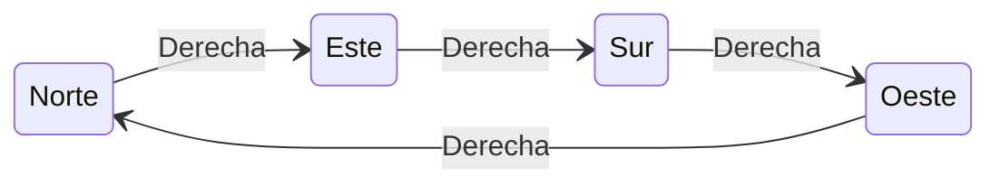
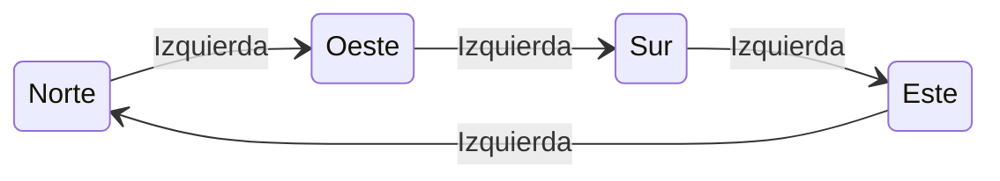
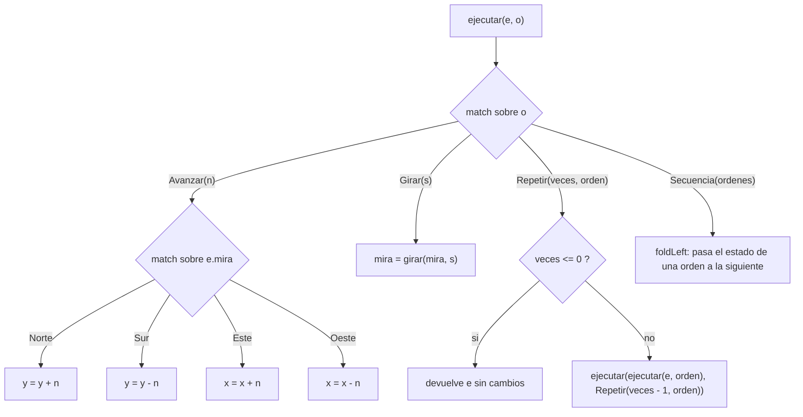
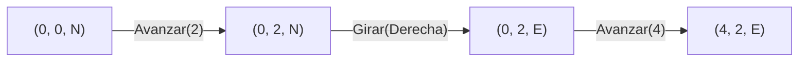
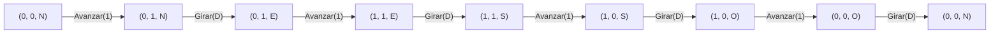
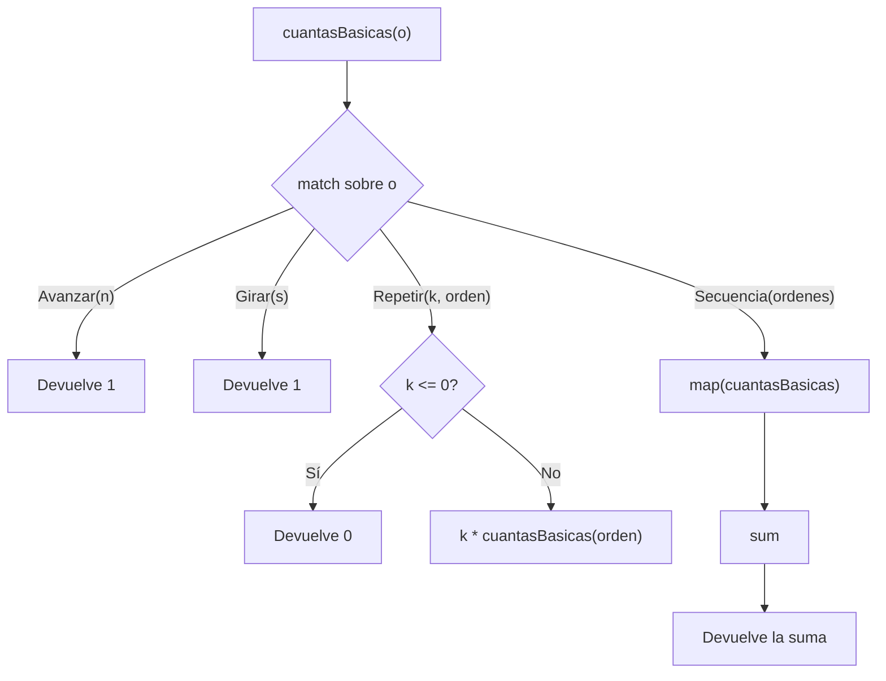
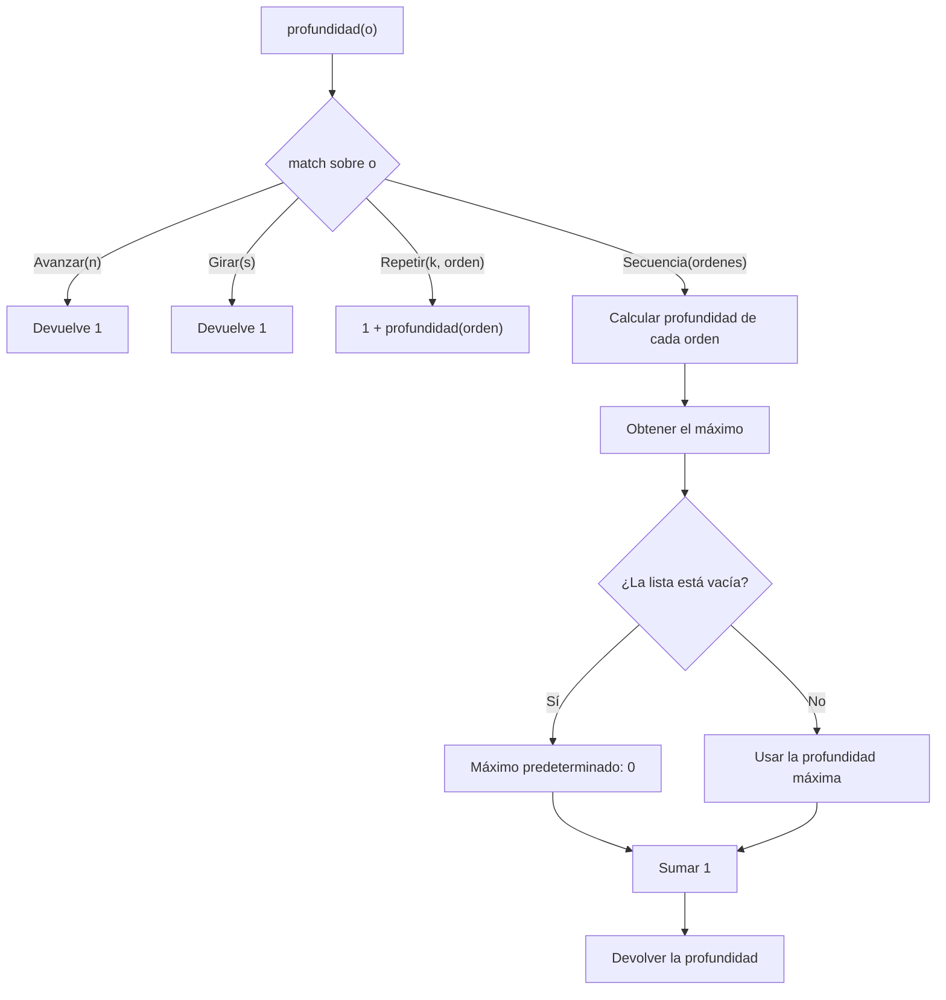
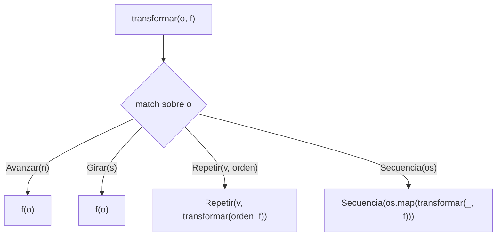
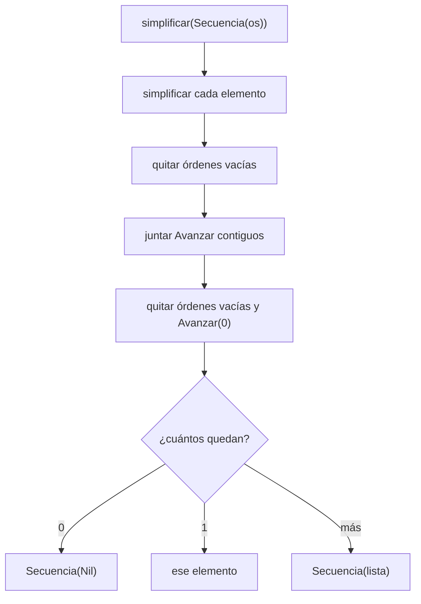

# Informe de proceso.

Este informe explica, paso a paso, cómo se ejecutan las funciones implementadas como solución a cada punto del taller.

**Convenciones usadas para los primeros dos puntos**

- Un estado se escribe como $(x, y, d)$, donde $d \in \{N, E, S, O\}$ es la dirección a la que mira el robot.
- El robot empieza en $(0, 0, N)$, es decir, `inicial`.
- Avanzar hacia el norte aumenta $y$; hacia el este aumenta $x$.
- Las flechas $\rightarrow$ indican "pasa a".

---

## Punto 1: `girar`

```scala
def girar(d: Direccion, s: Sentido): Direccion = (d, s) match {
  case (Norte, Derecha)   => Este
  case (Este,  Derecha)   => Sur
  case (Sur,   Derecha)   => Oeste
  case (Oeste, Derecha)   => Norte
  case (Norte, Izquierda) => Oeste
  case (Oeste, Izquierda) => Sur
  case (Sur,   Izquierda) => Este
  case (Este,  Izquierda) => Norte
}
```

### Idea general

`girar` no calcula nada: consulta una tabla. Se arma la pareja `(d, s)` y `match` busca el único caso que coincide con ella. Hay $4 \times 2 = 8$ combinaciones posibles (4 direcciones por 2 sentidos) y hay exactamente un caso por cada una. Como `Direccion` y `Sentido` son `sealed`, el compilador avisa si falta alguna.

### Ejecución paso a paso

1. Se recibe la dirección actual `d` y el sentido `s`.
2. Se construye la pareja `(d, s)`.
3. Se compara con los casos de arriba hacia abajo hasta encontrar el que coincide.
4. Se devuelve la dirección del lado derecho de la flecha `=>`.

### Diagramas de las transiciones

Girar a la derecha recorre las direcciones en el sentido de las manecillas del reloj:



Girar a la izquierda las recorre al revés:



### Trazas

| Llamada | Pareja evaluada | Caso que coincide | Resultado |
|---|---|---|---|
| `girar(Norte, Derecha)` | `(Norte, Derecha)` | 1.º | `Este` |
| `girar(Norte, Izquierda)` | `(Norte, Izquierda)` | 5.º | `Oeste` |
| `girar(Oeste, Derecha)` | `(Oeste, Derecha)` | 4.º | `Norte` |
| `girar(Sur, Izquierda)` | `(Sur, Izquierda)` | 7.º | `Este` |

**Traza de cuatro giros a la derecha seguidos** desde el norte:

$$N \xrightarrow{D} E \xrightarrow{D} S \xrightarrow{D} O \xrightarrow{D} N$$

Cuatro giros de noventa grados suman una vuelta completa, así que el robot termina mirando a donde miraba al principio.

---

## Punto 2: `ejecutar`

```scala
def ejecutar(e: Estado, o: Orden): Estado = o match {
  case Avanzar(n) =>
    e.mira match {
      case Norte => e.copy(y = e.y + n)
      case Sur   => e.copy(y = e.y - n)
      case Este  => e.copy(x = e.x + n)
      case Oeste => e.copy(x = e.x - n)
    }

  case Girar(s) =>
    e.copy(mira = girar(e.mira, s))

  case Repetir(veces, _) if veces <= 0 =>
    e

  case Repetir(veces, orden) =>
    ejecutar(ejecutar(e, orden), Repetir(veces - 1, orden))

  case Secuencia(ordenes) =>
    ordenes.foldLeft(e)((acc, ord) => ejecutar(acc, ord))
}
```

### Idea general

`Orden` es un tipo recursivo: `Repetir` y `Secuencia` contienen otras órdenes. Por eso `ejecutar` también es recursiva y sigue la forma del tipo, con un caso por cada alternativa. Las órdenes básicas (`Avanzar` y `Girar`) son los casos base. Las compuestas (`Repetir` y `Secuencia`) se resuelven llamando de nuevo a `ejecutar` sobre las órdenes que contienen.



### Ejecución paso a paso, caso por caso

**`Avanzar(n)`**
1. Se mira hacia dónde apunta `e.mira`.
2. Si mira al norte o al sur se modifica $y$ (suma o resta $n$); si mira al este o al oeste se modifica $x$.
3. Con `copy` se crea un estado nuevo y el original no cambia.
4. Con $n$ negativo no hace falta un caso extra: sumar un número negativo equivale a retroceder.

**`Girar(s)`**
1. Se llama a `girar(e.mira, s)` del punto 1.
2. Se crea un estado con la nueva dirección. La posición $(x, y)$ no cambia.

**`Repetir(veces, orden)`**
1. Si `veces <= 0`, se devuelve `e` tal cual (caso base, no hace nada).
2. Si no, se ejecuta `orden` una vez y al estado resultante se le aplica `Repetir(veces - 1, orden)`.
3. Cada llamada reduce `veces` en 1, así que la recursión llega al caso base y termina.

Se puede escribir como una relación de recurrencia, con $\mathrm{ej}(o, e)$ el estado que resulta de ejecutar $o$ en $e$:

$$\mathrm{ej}(\texttt{Repetir}(0, o),\, e) = e$$

$$\mathrm{ej}(\texttt{Repetir}(k, o),\, e) = \mathrm{ej}(\texttt{Repetir}(k-1, o),\, \mathrm{ej}(o, e)), \quad k > 0$$
**`Secuencia(ordenes)`**
1. `foldLeft` empieza con el estado `e` como acumulador.
2. Para cada orden de la lista, en su orden, se ejecuta sobre el acumulador y el resultado pasa a ser el nuevo acumulador.
3. Al terminar la lista se devuelve el acumulador. Con la lista vacía no hay pasos y se devuelve `e`.

---

### Trazas de posiciones

#### Traza 1: `ejecutar(inicial, Avanzar(3))`

| Paso | Acción | Estado |
|---|---|---|
| 0 | Inicio | $(0, 0, N)$ |
| 1 | `Avanzar(3)`: mira al norte, $y = 0 + 3$ | $(0, 3, N)$ |

**Resultado:** `Estado(0, 3, Norte)`

#### Traza 2: `ejecutar(inicial, Secuencia(List(Avanzar(2), Girar(Derecha), Avanzar(4))))`

| Paso | Orden | Cálculo | Estado |
|---|---|---|---|
| 0 | (inicio) | | $(0, 0, N)$ |
| 1 | `Avanzar(2)` | norte: $y = 0 + 2$ | $(0, 2, N)$ |
| 2 | `Girar(Derecha)` | `girar(Norte, Derecha) = Este` | $(0, 2, E)$ |
| 3 | `Avanzar(4)` | este: $x = 0 + 4$ | $(4, 2, E)$ |

**Resultado:** `Estado(4, 2, Este)`



#### Traza 3: el cuadrado, `ejecutar(inicial, Repetir(4, Secuencia(List(Avanzar(1), Girar(Derecha)))))`

Cada vuelta de `Repetir` ejecuta la secuencia completa (un avance y un giro), y hay 4 vueltas:

| Vuelta | Orden | Estado |
|---|---|---|
| | (inicio) | $(0, 0, N)$ |
| 1 | `Avanzar(1)` | $(0, 1, N)$ |
| 1 | `Girar(Derecha)` | $(0, 1, E)$ |
| 2 | `Avanzar(1)` | $(1, 1, E)$ |
| 2 | `Girar(Derecha)` | $(1, 1, S)$ |
| 3 | `Avanzar(1)` | $(1, 0, S)$ |
| 3 | `Girar(Derecha)` | $(1, 0, O)$ |
| 4 | `Avanzar(1)` | $(0, 0, O)$ |
| 4 | `Girar(Derecha)` | $(0, 0, N)$ |

**Resultado:** `Estado(0, 0, Norte)`. El robot dibujó un cuadrado y volvió al punto de partida mirando al norte.



#### Traza 4: paso negativo, `ejecutar(inicial, Avanzar(-2))`

| Paso | Acción | Estado |
|---|---|---|
| 0 | Inicio | $(0, 0, N)$ |
| 1 | `Avanzar(-2)`: norte, $y = 0 + (-2)$ | $(0, -2, N)$ |

**Resultado:** `Estado(0, -2, Norte)`. Retrocede sin que `Avanzar` tenga un caso especial.

#### Traza 5: repetir cero veces, `ejecutar(inicial, Repetir(0, Avanzar(5)))`

| Paso | Acción | Estado |
|---|---|---|
| 0 | Inicio | $(0, 0, N)$ |
| 1 | `Repetir(0, _)`: se cumple la guarda `veces <= 0`, se devuelve `e` | $(0, 0, N)$ |

**Resultado:** `Estado(0, 0, Norte)`. El `Avanzar(5)` nunca llega a ejecutarse.

#### Traza 6: cómo se desenrolla la recursión de `Repetir`, `ejecutar(inicial, Repetir(3, Avanzar(2)))`

```text
ejecutar((0,0,N), Repetir(3, Avanzar(2)))
= ejecutar( ejecutar((0,0,N), Avanzar(2)), Repetir(2, Avanzar(2)) )
= ejecutar( (0,2,N), Repetir(2, Avanzar(2)) )
= ejecutar( ejecutar((0,2,N), Avanzar(2)), Repetir(1, Avanzar(2)) )
= ejecutar( (0,4,N), Repetir(1, Avanzar(2)) )
= ejecutar( ejecutar((0,4,N), Avanzar(2)), Repetir(0, Avanzar(2)) )
= ejecutar( (0,6,N), Repetir(0, Avanzar(2)) )
= (0,6,N)          <- caso base: veces <= 0
```

**Resultado:** `Estado(0, 6, Norte)`.

#### Traza 7: `foldLeft` sobre una secuencia, `ejecutar(inicial, Secuencia(List(Avanzar(1), Girar(Izquierda), Avanzar(3))))`

| Elemento | Acumulador antes | Acumulador después |
|---|---|---|
| (valor inicial) | | $(0, 0, N)$ |
| `Avanzar(1)` | $(0, 0, N)$ | $(0, 1, N)$ |
| `Girar(Izquierda)` | $(0, 1, N)$ | $(0, 1, O)$ |
| `Avanzar(3)` | $(0, 1, O)$ | $(-3, 1, O)$ |

**Resultado:** `Estado(-3, 1, Oeste)`. Mirando al oeste, avanzar resta a $x$.

## Punto 3: `cuantasBasicas` y `profundidad`

### Idea general

El tipo `Orden` contiene cuatro alternativas:

- `Avanzar(n)`: orden básica que indica avanzar una cantidad de pasos.
- `Girar(s)`: orden básica que indica girar hacia la derecha o hacia la izquierda.
- `Repetir(veces, orden)`: orden compuesta que repite otra orden.
- `Secuencia(ordenes)`: orden compuesta que contiene una lista de órdenes.

Las funciones del punto 3 recorren esta estructura recursiva, pero no ejecutan los movimientos del robot.

**`cuantasBasicas(o)`** cuenta las órdenes básicas `Avanzar` y `Girar` que se ejecutarían, teniendo en cuenta las repeticiones.

**`profundidad(o)`** calcula el nivel de anidamiento de la orden. Una orden básica tiene profundidad 1 y una orden compuesta tiene profundidad 1 más que la mayor profundidad de sus componentes.

---

## 3.2. Función `cuantasBasicas`

### Código Scala

```scala
def cuantasBasicas(o: Orden): Int = o match {
  case Avanzar(_) => 1
  case Girar(_) => 1

  case Repetir(veces, orden) =>
    if (veces <= 0) 0
    else veces * cuantasBasicas(orden)

  case Secuencia(ordenes) =>
    ordenes.map(cuantasBasicas).sum
}
```

### Idea general

La función utiliza `match` para identificar la alternativa de `Orden` que recibe.

Las órdenes básicas, `Avanzar` y `Girar`, cuentan como una unidad cada una. En el caso de `Repetir`, se calcula cuántas órdenes básicas contiene la orden repetida y se multiplica por el número de repeticiones. Si el número de repeticiones es cero o negativo, el resultado es cero.

En el caso de `Secuencia`, se cuentan las órdenes básicas de cada elemento de la lista y se suman los resultados. Si la lista está vacía, la suma es cero.

### Ejecución paso a paso

**Caso `Avanzar(n)`**

1. La función recibe una orden `Avanzar`.
2. No necesita conocer el valor de `n`, porque solo importa contar la orden.
3. Devuelve `1`.

**Caso `Girar(s)`**

1. La función recibe una orden `Girar`.
2. No necesita conocer el sentido del giro.
3. Devuelve `1`.

**Caso `Repetir(veces, orden)`**

1. Se obtiene el número de repeticiones y la orden que se repetirá.
2. Si `veces <= 0`, devuelve `0`.
3. Si `veces > 0`, calcula recursivamente las órdenes básicas contenidas en `orden`.
4. Multiplica el resultado por `veces`.

La regla matemática es:

$
B(\operatorname{Avanzar}(n)) = 1
$

$
B(\operatorname{Girar}(s)) = 1
$

$
B(\operatorname{Repetir}(k,o))= \begin{cases} 0 & \text{si } k\leq 0,\\ kB(o) & \text{si } k>0. \end{cases}
$

**Caso `Secuencia(ordenes)`**

1. Se obtiene la lista de órdenes.
2. `map(cuantasBasicas)` calcula el conteo de cada elemento.
3. `sum` suma todos los conteos.
4. Si la lista está vacía, devuelve `0`.

La regla matemática es:

$
B(\operatorname{Secuencia}([o_1,\ldots,o_m])) = \sum_{i=1}^{m}B(o_i)
$ 

Para la lista vacía, la suma se considera igual a cero.

### Diagrama de flujo



### Trazas de ejecución

#### Traza 1: una orden básica

Llamada:

```scala
cuantasBasicas(Avanzar(3))
```

| Paso | Acción | Resultado |
|---|---|---:|
| 1 | Se identifica `Avanzar(3)` | — |
| 2 | Se aplica el caso de una orden básica | 1 |

**Resultado:** `1`.

Aunque la orden indique avanzar tres pasos, cuenta como una sola orden básica.

#### Traza 2: una secuencia de órdenes básicas

Llamada:

```scala
cuantasBasicas(
  Secuencia(List(Avanzar(2), Girar(Derecha), Avanzar(4)))
)
```

| Paso | Orden | Conteo |
|---|---|---:|
| 1 | `Avanzar(2)` | 1 |
| 2 | `Girar(Derecha)` | 1 |
| 3 | `Avanzar(4)` | 1 |
| 4 | Suma de los conteos | 3 |

**Resultado:** `3`.

#### Traza 3: repetir una orden compuesta

Se utiliza el cuadrado definido en el enunciado:

```scala
val cuadrado =
  Repetir(4, Secuencia(List(Avanzar(1), Girar(Derecha))))
```

Llamada:

```scala
cuantasBasicas(cuadrado)
```

| Paso | Acción | Resultado |
|---|---|---:|
| 1 | Se identifica `Repetir(4, orden)` | — |
| 2 | Se cuenta `Avanzar(1)` | 1 |
| 3 | Se cuenta `Girar(Derecha)` | 1 |
| 4 | Se suman las órdenes de la secuencia | 2 |
| 5 | Se multiplica por las 4 repeticiones | \(4\times 2=8\) |

**Resultado:** `8`.

#### Traza 4: repetir cero veces

Llamada:

```scala
cuantasBasicas(Repetir(0, Avanzar(5)))
```

| Paso | Acción | Resultado |
|---|---|---:|
| 1 | Se identifica `Repetir(0, orden)` | — |
| 2 | Se comprueba `veces <= 0` | Verdadero |
| 3 | Se devuelve cero sin contar la orden interna | 0 |

**Resultado:** `0`.

#### Traza 5: secuencia vacía

Llamada:

```scala
cuantasBasicas(Secuencia(Nil))
```

| Paso | Acción | Resultado |
|---|---|---:|
| 1 | Se identifica `Secuencia(Nil)` | — |
| 2 | Se aplica `map` a la lista vacía | `Nil` |
| 3 | Se suman los elementos de la lista vacía | 0 |

**Resultado:** `0`.

---

## 3.3. Función `profundidad`

### Código Scala

```scala
def profundidad(o: Orden): Int = o match {
  case Avanzar(_) => 1
  case Girar(_) => 1

  case Repetir(_, orden) =>
    1 + profundidad(orden)

  case Secuencia(ordenes) =>
    1 + (ordenes.map(profundidad).maxOption.getOrElse(0))
}
```

### Idea general

La función calcula cuántos niveles de anidamiento tiene una orden.

Las órdenes básicas tienen profundidad 1, porque no contienen otras órdenes.

En `Repetir`, la profundidad corresponde a un nivel adicional más la profundidad de la orden repetida.

En `Secuencia`, se calcula la profundidad de cada elemento, se selecciona la mayor y se suma uno para contar el nivel de la propia secuencia. Si la lista está vacía, `maxOption` no encuentra un máximo y `getOrElse(0)` proporciona cero. Por eso, una secuencia vacía tiene profundidad 1.

### Ejecución paso a paso

**Caso `Avanzar(n)`**

1. Se identifica la orden básica.
2. Como no contiene otras órdenes, devuelve `1`.

**Caso `Girar(s)`**

1. Se identifica la orden básica.
2. Como no contiene otras órdenes, devuelve `1`.

**Caso `Repetir(veces, orden)`**

1. Se obtiene la orden interna.
2. Se calcula recursivamente su profundidad.
3. Se suma `1` para incluir el nivel de `Repetir`.

La regla matemática es:

$
P(\operatorname{Repetir}(k,o))=1+P(o)
$

El número de repeticiones no afecta a la profundidad: repetir una orden una vez o diez veces no agrega niveles de anidamiento adicionales.

**Caso `Secuencia(ordenes)`**

1. Se calcula la profundidad de cada orden de la lista.
2. Se obtiene la profundidad máxima.
3. Se suma `1` para incluir el nivel de la secuencia.
4. Si no hay elementos, se utiliza `0` como máximo predeterminado.

La regla matemática es:

$
P(\operatorname{Secuencia}(os))=
1+\max\left(\{P(o):o\in os\}\cup\{0\}\right)
$

Por lo tanto, la secuencia vacía tiene profundidad \(1+0=1\).

### Diagrama de flujo



### Trazas de ejecución

#### Traza 1: una orden básica

Llamada:

```scala
profundidad(Avanzar(3))
```

| Paso | Acción | Resultado |
|---|---|---:|
| 1 | Se identifica `Avanzar(3)` | — |
| 2 | Se aplica el caso básico | 1 |

**Resultado:** `1`.

#### Traza 2: una secuencia de órdenes básicas

Llamada:

```scala
profundidad(Secuencia(List(Avanzar(1), Girar(Derecha))))
```

| Paso | Acción | Resultado |
|---|---|---:|
| 1 | Profundidad de `Avanzar(1)` | 1 |
| 2 | Profundidad de `Girar(Derecha)` | 1 |
| 3 | Se obtiene el máximo: `max(1, 1)` | 1 |
| 4 | Se suma el nivel de `Secuencia` | \(1+1=2\) |

**Resultado:** `2`.

#### Traza 3: el cuadrado

Llamada:

```scala
profundidad(cuadrado)
```

Donde:

```scala
val cuadrado =
  Repetir(4, Secuencia(List(Avanzar(1), Girar(Derecha))))
```

| Paso | Acción | Resultado |
|---|---|---:|
| 1 | Profundidad de `Avanzar(1)` | 1 |
| 2 | Profundidad de `Girar(Derecha)` | 1 |
| 3 | Profundidad de la secuencia: \(1+\max(1,1)\) | 2 |
| 4 | Profundidad de `Repetir`: \(1+2\) | 3 |

**Resultado:** `3`.

La estructura tiene tres niveles: `Repetir`, `Secuencia` y las órdenes básicas.

#### Traza 4: secuencia vacía

Llamada:

```scala
profundidad(Secuencia(Nil))
```

| Paso | Acción | Resultado |
|---|---|---:|
| 1 | Se identifica `Secuencia(Nil)` | — |
| 2 | No hay profundidades que calcular | — |
| 3 | `maxOption` devuelve `None` | — |
| 4 | `getOrElse(0)` establece el máximo en cero | 0 |
| 5 | Se suma uno por el nivel de `Secuencia` | 1 |

**Resultado:** `1`.

#### Traza 5: una secuencia con una rama más profunda

Llamada:

```scala
profundidad(Secuencia(List(Avanzar(1), cuadrado)))
```

| Paso | Acción | Resultado |
|---|---|---:|
| 1 | Profundidad de `Avanzar(1)` | 1 |
| 2 | Profundidad de `cuadrado` | 3 |
| 3 | Se obtiene el máximo: `max(1, 3)` | 3 |
| 4 | Se suma el nivel de la secuencia exterior | \(1+3=4\) |

**Resultado:** `4`.

La profundidad de la rama más profunda determina el resultado. Las ramas más superficiales no reducen ese valor.

---

## 3.4. Comparación entre las dos funciones

Aunque ambas recorren recursivamente la estructura de `Orden`, cada función mide algo diferente.

| Característica | `cuantasBasicas` | `profundidad` |
|---|---|---|
| Qué calcula | Número de órdenes básicas | Niveles de anidamiento |
| `Avanzar` | Devuelve 1 | Devuelve 1 |
| `Girar` | Devuelve 1 | Devuelve 1 |
| `Repetir` | Multiplica por las repeticiones | Suma un nivel a la profundidad interna |
| `Secuencia` | Suma los conteos | Suma 1 a la profundidad máxima |
| Secuencia vacía | Devuelve 0 | Devuelve 1 |
| Repetición cero | Devuelve 0 | Depende de la estructura de la orden contenida |

La última fila es importante: `profundidad` mide la estructura de la orden escrita, no cuántas veces se ejecutaría. Por eso, `Repetir(0, Avanzar(5))` tiene profundidad 2, aunque `cuantasBasicas` devuelva 0.

---

## 3.5. Verificación conjunta con los ejemplos

Se resumen los resultados esperados para las dos funciones:

| Orden | `cuantasBasicas` | `profundidad` |
|---|---:|---:|
| `Avanzar(3)` | 1 | 1 |
| `Girar(Derecha)` | 1 | 1 |
| `Secuencia(List(Avanzar(1), Girar(Derecha)))` | 2 | 2 |
| `Repetir(4, Secuencia(List(Avanzar(1), Girar(Derecha))))` | 8 | 3 |
| `Repetir(0, Avanzar(5))` | 0 | 2 |
| `Secuencia(Nil)` | 0 | 1 |
| `Secuencia(List(Avanzar(1), cuadrado))` | 9 | 4 |

En el último ejemplo, `cuantasBasicas` devuelve \(1+8=9\), porque cuenta el `Avanzar(1)` exterior y las ocho órdenes básicas del cuadrado.

---

## 3.6. Cumplimiento de las restricciones del taller

| Restricción | Cumplimiento |
|---|---|
| Uso de `match` | Las funciones distinguen las cuatro alternativas de `Orden` mediante patrones. |
| Sin variables mutables | No se modifica ningún estado ni se utiliza `var`. |
| Sin ciclos `for` o `while` | Se utilizan recursión y operaciones funcionales sobre listas. |
| Sin `return` | Cada rama devuelve directamente el resultado de su expresión. |
| Sin ejecutar las órdenes | Las funciones analizan la estructura de `Orden`; no llaman a `ejecutar`. |
| Modelo de datos sin modificar | Se utilizan los constructores `Avanzar`, `Girar`, `Repetir` y `Secuencia` existentes. |

---

## Conclusión

Las funciones `cuantasBasicas` y `profundidad` recorren la estructura recursiva de una orden utilizando `match`.

`cuantasBasicas` cuenta las órdenes básicas que se ejecutarían, teniendo en cuenta las repeticiones y sumando los elementos de las secuencias. `profundidad` calcula los niveles de anidamiento, sumando un nivel para cada orden compuesta y tomando la rama más profunda en las secuencias.

Ambas funciones trabajan sin modificar el estado del robot y sin ejecutar movimientos. Así, permiten analizar una orden antes de pasarla a la función `ejecutar`.


---
## Punto 4: rutinas con funciones de alto orden

```scala
def componer(o1: Orden, o2: Orden): Orden =
  Secuencia(List(o1, o2))

def rutina(pasos: Int)(giro: Sentido)(veces: Int): Orden =
  Repetir(veces, Secuencia(List(Avanzar(pasos), Girar(giro))))

def aplicarA(estados: List[Estado], o: Orden): List[Estado] =
  estados.map(e => ejecutar(e, o))

def transformar(o: Orden, f: Orden => Orden): Orden = o match {
  case Avanzar(_) => f(o)
  case Girar(_) => f(o)
  case Repetir(veces, orden) => Repetir(veces, transformar(orden, f))
  case Secuencia(ordenes) => Secuencia(ordenes.map(x => transformar(x, f)))
}
```

### Ejecución paso a paso

**`componer(o1, o2)`**
1. Recibe dos órdenes.
2. Devuelve `Secuencia(List(o1, o2))`. No ejecuta nada: solo construye la orden.

**`rutina(pasos)(giro)(veces)`**
1. Está currificada. `rutina(pasos)` es una función `Sentido => Int => Orden`, y `rutina(pasos)(giro)` es una función `Int => Orden` que espera las veces.
2. Al recibir `veces`, arma `Repetir(veces, Secuencia(List(Avanzar(pasos), Girar(giro))))`.

**`aplicarA(estados, o)`**
1. `map` recorre la lista de estados.
2. A cada estado `e` le aplica `ejecutar(e, o)`.
3. Devuelve una lista nueva, del mismo largo y en el mismo orden.

**`transformar(o, f)`**
1. `Avanzar` y `Girar` son órdenes básicas: se devuelve `f(o)`.
2. `Repetir(veces, orden)` conserva `veces` y transforma `orden` recursivamente.
3. `Secuencia(ordenes)` transforma cada elemento con `map` y conserva el orden.



### Trazas de posiciones

#### Traza 1: `componer`, `ejecutar(inicial, componer(Avanzar(2), Girar(Derecha)))`

| Paso | Orden | Estado |
|---|---|---|
| 0 | (inicio) | $(0, 0, N)$ |
| 1 | `Avanzar(2)` | $(0, 2, N)$ |
| 2 | `Girar(Derecha)` | $(0, 2, E)$ |

**Resultado:** `Estado(0, 2, Este)`.

#### Traza 2: `rutina`, `ejecutar(inicial, rutina(2)(Izquierda)(3))`

`rutina(2)(Izquierda)(3)` construye `Repetir(3, Secuencia(List(Avanzar(2), Girar(Izquierda))))`.

| Vuelta | Orden | Cálculo | Estado |
|---|---|---|---|
| | (inicio) | | $(0, 0, N)$ |
| 1 | `Avanzar(2)` | norte: $y = 0 + 2$ | $(0, 2, N)$ |
| 1 | `Girar(Izquierda)` | Norte a la izquierda es Oeste | $(0, 2, O)$ |
| 2 | `Avanzar(2)` | oeste: $x = 0 - 2$ | $(-2, 2, O)$ |
| 2 | `Girar(Izquierda)` | Oeste a la izquierda es Sur | $(-2, 2, S)$ |
| 3 | `Avanzar(2)` | sur: $y = 2 - 2$ | $(-2, 0, S)$ |
| 3 | `Girar(Izquierda)` | Sur a la izquierda es Este | $(-2, 0, E)$ |

**Resultado:** `Estado(-2, 0, Este)`.

#### Traza 3: `aplicarA(List(Estado(0, 0, Este), Estado(2, 3, Oeste)), Avanzar(4))`

| Estado inicial | Cálculo | Estado final |
|---|---|---|
| $(0, 0, E)$ | este: $x = 0 + 4$ | $(4, 0, E)$ |
| $(2, 3, O)$ | oeste: $x = 2 - 4$ | $(-2, 3, O)$ |

**Resultado:** `List(Estado(4, 0, Este), Estado(-2, 3, Oeste))`.

#### Traza 4: `transformar` triplicando los avances

Orden: `Repetir(2, Secuencia(List(Avanzar(1), Girar(Izquierda))))`, con `f = { case Avanzar(n) => Avanzar(3 * n); case otra => otra }`.

```text
transformar(Repetir(2, Secuencia(List(Avanzar(1), Girar(Izquierda)))), f)
= Repetir(2, transformar(Secuencia(List(Avanzar(1), Girar(Izquierda))), f))
= Repetir(2, Secuencia(List(transformar(Avanzar(1), f), transformar(Girar(Izquierda), f))))
= Repetir(2, Secuencia(List(f(Avanzar(1)), f(Girar(Izquierda)))))
= Repetir(2, Secuencia(List(Avanzar(3), Girar(Izquierda))))
```

| Orden | Posiciones desde `inicial` |
|---|---|
| Original | $(0,0,N) \to (0,1,N) \to (0,1,O) \to (-1,1,O) \to (-1,1,S)$ |
| Transformada | $(0,0,N) \to (0,3,N) \to (0,3,O) \to (-3,3,O) \to (-3,3,S)$ |

La estructura (`Repetir`, `Secuencia`, los giros) no cambia. Solo cambian los avances.

---

## Punto 5: `simplificar`

```scala
def simplificar(o: Orden): Orden = {
  val nada: Orden = Secuencia(Nil)

  def juntar(l: List[Orden]): List[Orden] = l match {
    case Avanzar(a) :: Avanzar(b) :: resto => juntar(Avanzar(a + b) :: resto)
    case x :: resto => x :: juntar(resto)
    case Nil => Nil
  }

  o match {
    case Avanzar(0) => nada
    case Avanzar(_) => o
    case Girar(_) => o
    case Repetir(veces, _) if veces <= 0 => nada
    case Repetir(veces, orden) =>
      simplificar(orden) match {
        case Secuencia(Nil) => nada
        case s if veces == 1 => s
        case s => Repetir(veces, s)
      }
    case Secuencia(ordenes) =>
      val hijos = ordenes.map(simplificar).filter(h => h != nada)
      juntar(hijos).filter(h => h != nada && h != Avanzar(0)) match {
        case Nil => nada
        case x :: Nil => x
        case xs => Secuencia(xs)
      }
  }
}
```

### Idea general

`simplificar` recorre la orden con `match`. Primero simplifica las órdenes interiores, y así las reglas se aplican de abajo hacia arriba, de modo que lo que una regla habilita lo aprovecha la siguiente. Con eso no hace falta repetir pasadas desde fuera: una sola llamada deja la orden en su forma final.

| Regla del enunciado | Dónde se aplica |
|---|---|
| 1. `Avanzar(0)` y `Repetir(0, _)` son `Secuencia(Nil)` | `case Avanzar(0)`, `case Repetir(veces, _) if veces <= 0`, y `Repetir` de una orden vacía |
| 2. Dos `Avanzar` seguidos se juntan | `juntar` |
| 3. `Repetir(1, o)` es `o` | `case s if veces == 1` |
| 4. Secuencia de un solo elemento es ese elemento | `case x :: Nil` |
| 5. Las órdenes vacías se quitan de las secuencias | los dos `filter` |

### Ejecución paso a paso (`Secuencia`)

1. Se simplifica cada orden de la lista y se descartan las que no hacen nada.
2. `juntar` suma los `Avanzar` contiguos. Si la suma da `Avanzar(0)`, ese resultado se vuelve a juntar con el siguiente si es otro `Avanzar`.
3. Se descartan las órdenes vacías y los `Avanzar(0)` que hayan quedado.
4. Lista vacía: `Secuencia(Nil)`. Un elemento: ese elemento. Si no, `Secuencia(xs)`.



### Trazas

#### Traza 1: reglas 2 y 4

`simplificar(Secuencia(List(Avanzar(2), Avanzar(3))))`: ambos hijos quedan igual. `juntar` da `List(Avanzar(5))`. Queda un solo elemento.

**Resultado:** `Avanzar(5)`.

#### Traza 2: `Repetir(0, Avanzar(9))`

Se cumple la guarda `veces <= 0`.

**Resultado:** `Secuencia(Nil)`.

#### Traza 3: avances que se cancelan, `Secuencia(List(Avanzar(2), Avanzar(-2)))`

| Paso | Acción | Resultado |
|---|---|---|
| 1 | Simplificar cada hijo | `List(Avanzar(2), Avanzar(-2))` |
| 2 | `juntar`: $2+(-2)=0$ | `List(Avanzar(0))` |
| 3 | Quitar `Avanzar(0)` (regla 5) | `Nil` |
| 4 | Lista vacía | `Secuencia(Nil)` |

**Resultado:** `Secuencia(Nil)`.

#### Traza 4: una orden que necesita varias reglas

`o = Secuencia(List(Avanzar(2), Repetir(1, Secuencia(List(Avanzar(3), Avanzar(0)))), Avanzar(-5), Girar(Derecha)))`

| Paso | Acción | Resultado |
|---|---|---|
| 1 | Simplificar `Avanzar(2)` | `Avanzar(2)` |
| 2 | Simplificar `Secuencia(List(Avanzar(3), Avanzar(0)))`: `Avanzar(0)` se vuelve vacía y se quita (regla 5) | lista `List(Avanzar(3))` |
| 3 | Un solo elemento (regla 4) | `Avanzar(3)` |
| 4 | `Repetir(1, Avanzar(3))` (regla 3) | `Avanzar(3)` |
| 5 | `Avanzar(-5)` y `Girar(Derecha)` | sin cambios |
| 6 | Lista de hijos | `List(Avanzar(2), Avanzar(3), Avanzar(-5), Girar(Derecha))` |
| 7 | `juntar`: $2+3=5$ | `List(Avanzar(5), Avanzar(-5), Girar(Derecha))` |
| 8 | `juntar`: $5+(-5)=0$ | `List(Avanzar(0), Girar(Derecha))` |
| 9 | Quitar `Avanzar(0)` (regla 5) | `List(Girar(Derecha))` |
| 10 | Un solo elemento (regla 4) | `Girar(Derecha)` |

**Resultado:** `Girar(Derecha)`.

Posiciones desde `inicial`:

| Orden | Posiciones |
|---|---|
| Original | $(0,0,N) \to (0,2,N) \to (0,5,N) \to (0,0,N) \to (0,0,E)$ |
| Simplificada | $(0,0,N) \to (0,0,E)$ |

Ambas terminan en `Estado(0, 0, Este)`.

#### Traza 5: `Repetir(3, Repetir(1, Avanzar(2)))`

La orden interior `Repetir(1, Avanzar(2))` pasa a `Avanzar(2)` (regla 3). Como 3 no es 1, queda `Repetir(3, Avanzar(2))`.
