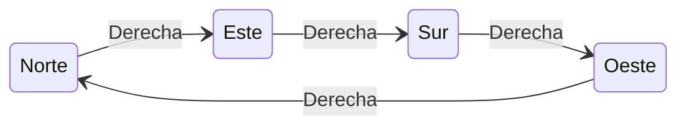
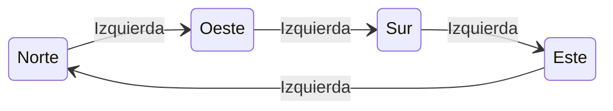
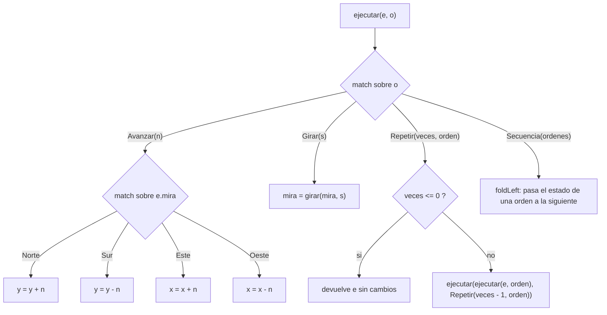
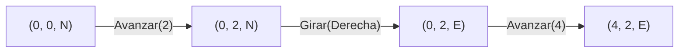
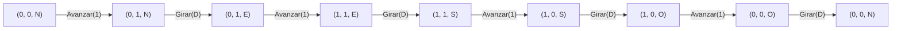

# Informe de proceso.

Este informe explica, paso a paso, cómo se ejecutan las funciones implementadas como solución a cada punto del taller.

**Convenciones usadas para los primeros dos puntos**

- Un estado se escribe como $(x, y, d)$, donde $d \in \{N, E, S, O\}$ es la dirección a la que mira el robot.
- El robot empieza en $(0, 0, N)$, es decir, `inicial`.
- Avanzar hacia el norte aumenta $y$; hacia el este aumenta $x$.
- Las flechas $\rightarrow$ indican "pasa a".

---

## Punto 1: `girar`

```scala
def girar(d: Direccion, s: Sentido): Direccion = (d, s) match {
  case (Norte, Derecha)   => Este
  case (Este,  Derecha)   => Sur
  case (Sur,   Derecha)   => Oeste
  case (Oeste, Derecha)   => Norte
  case (Norte, Izquierda) => Oeste
  case (Oeste, Izquierda) => Sur
  case (Sur,   Izquierda) => Este
  case (Este,  Izquierda) => Norte
}
```

### Idea general

`girar` no calcula nada: consulta una tabla. Se arma la pareja `(d, s)` y `match` busca el único caso que coincide con ella. Hay $4 \times 2 = 8$ combinaciones posibles (4 direcciones por 2 sentidos) y hay exactamente un caso por cada una. Como `Direccion` y `Sentido` son `sealed`, el compilador avisa si falta alguna.

### Ejecución paso a paso

1. Se recibe la dirección actual `d` y el sentido `s`.
2. Se construye la pareja `(d, s)`.
3. Se compara con los casos de arriba hacia abajo hasta encontrar el que coincide.
4. Se devuelve la dirección del lado derecho de la flecha `=>`.

### Diagramas de las transiciones

Girar a la derecha recorre las direcciones en el sentido de las manecillas del reloj:



Girar a la izquierda las recorre al revés:



### Trazas

| Llamada | Pareja evaluada | Caso que coincide | Resultado |
|---|---|---|---|
| `girar(Norte, Derecha)` | `(Norte, Derecha)` | 1.º | `Este` |
| `girar(Norte, Izquierda)` | `(Norte, Izquierda)` | 5.º | `Oeste` |
| `girar(Oeste, Derecha)` | `(Oeste, Derecha)` | 4.º | `Norte` |
| `girar(Sur, Izquierda)` | `(Sur, Izquierda)` | 7.º | `Este` |

**Traza de cuatro giros a la derecha seguidos** desde el norte:

$$N \xrightarrow{D} E \xrightarrow{D} S \xrightarrow{D} O \xrightarrow{D} N$$

Cuatro giros de noventa grados suman una vuelta completa, así que el robot termina mirando a donde miraba al principio.

---

## Punto 2: `ejecutar`

```scala
def ejecutar(e: Estado, o: Orden): Estado = o match {
  case Avanzar(n) =>
    e.mira match {
      case Norte => e.copy(y = e.y + n)
      case Sur   => e.copy(y = e.y - n)
      case Este  => e.copy(x = e.x + n)
      case Oeste => e.copy(x = e.x - n)
    }

  case Girar(s) =>
    e.copy(mira = girar(e.mira, s))

  case Repetir(veces, _) if veces <= 0 =>
    e

  case Repetir(veces, orden) =>
    ejecutar(ejecutar(e, orden), Repetir(veces - 1, orden))

  case Secuencia(ordenes) =>
    ordenes.foldLeft(e)((acc, ord) => ejecutar(acc, ord))
}
```

### Idea general

`Orden` es un tipo recursivo: `Repetir` y `Secuencia` contienen otras órdenes. Por eso `ejecutar` también es recursiva y sigue la forma del tipo, con un caso por cada alternativa. Las órdenes básicas (`Avanzar` y `Girar`) son los casos base. Las compuestas (`Repetir` y `Secuencia`) se resuelven llamando de nuevo a `ejecutar` sobre las órdenes que contienen.



### Ejecución paso a paso, caso por caso

**`Avanzar(n)`**
1. Se mira hacia dónde apunta `e.mira`.
2. Si mira al norte o al sur se modifica $y$ (suma o resta $n$); si mira al este o al oeste se modifica $x$.
3. Con `copy` se crea un estado nuevo y el original no cambia.
4. Con $n$ negativo no hace falta un caso extra: sumar un número negativo equivale a retroceder.

**`Girar(s)`**
1. Se llama a `girar(e.mira, s)` del punto 1.
2. Se crea un estado con la nueva dirección. La posición $(x, y)$ no cambia.

**`Repetir(veces, orden)`**
1. Si `veces <= 0`, se devuelve `e` tal cual (caso base, no hace nada).
2. Si no, se ejecuta `orden` una vez y al estado resultante se le aplica `Repetir(veces - 1, orden)`.
3. Cada llamada reduce `veces` en 1, así que la recursión llega al caso base y termina.

Se puede escribir como una relación de recurrencia, con $\mathrm{ej}(o, e)$ el estado que resulta de ejecutar $o$ en $e$:

$$\mathrm{ej}(\texttt{Repetir}(0, o),\, e) = e$$

$$\mathrm{ej}(\texttt{Repetir}(k, o),\, e) = \mathrm{ej}(\texttt{Repetir}(k-1, o),\, \mathrm{ej}(o, e)), \quad k > 0$$
**`Secuencia(ordenes)`**
1. `foldLeft` empieza con el estado `e` como acumulador.
2. Para cada orden de la lista, en su orden, se ejecuta sobre el acumulador y el resultado pasa a ser el nuevo acumulador.
3. Al terminar la lista se devuelve el acumulador. Con la lista vacía no hay pasos y se devuelve `e`.

---

### Trazas de posiciones

#### Traza 1: `ejecutar(inicial, Avanzar(3))`

| Paso | Acción | Estado |
|---|---|---|
| 0 | Inicio | $(0, 0, N)$ |
| 1 | `Avanzar(3)`: mira al norte, $y = 0 + 3$ | $(0, 3, N)$ |

**Resultado:** `Estado(0, 3, Norte)`

#### Traza 2: `ejecutar(inicial, Secuencia(List(Avanzar(2), Girar(Derecha), Avanzar(4))))`

| Paso | Orden | Cálculo | Estado |
|---|---|---|---|
| 0 | (inicio) | | $(0, 0, N)$ |
| 1 | `Avanzar(2)` | norte: $y = 0 + 2$ | $(0, 2, N)$ |
| 2 | `Girar(Derecha)` | `girar(Norte, Derecha) = Este` | $(0, 2, E)$ |
| 3 | `Avanzar(4)` | este: $x = 0 + 4$ | $(4, 2, E)$ |

**Resultado:** `Estado(4, 2, Este)`



#### Traza 3: el cuadrado, `ejecutar(inicial, Repetir(4, Secuencia(List(Avanzar(1), Girar(Derecha)))))`

Cada vuelta de `Repetir` ejecuta la secuencia completa (un avance y un giro), y hay 4 vueltas:

| Vuelta | Orden | Estado |
|---|---|---|
| | (inicio) | $(0, 0, N)$ |
| 1 | `Avanzar(1)` | $(0, 1, N)$ |
| 1 | `Girar(Derecha)` | $(0, 1, E)$ |
| 2 | `Avanzar(1)` | $(1, 1, E)$ |
| 2 | `Girar(Derecha)` | $(1, 1, S)$ |
| 3 | `Avanzar(1)` | $(1, 0, S)$ |
| 3 | `Girar(Derecha)` | $(1, 0, O)$ |
| 4 | `Avanzar(1)` | $(0, 0, O)$ |
| 4 | `Girar(Derecha)` | $(0, 0, N)$ |

**Resultado:** `Estado(0, 0, Norte)`. El robot dibujó un cuadrado y volvió al punto de partida mirando al norte.



#### Traza 4: paso negativo, `ejecutar(inicial, Avanzar(-2))`

| Paso | Acción | Estado |
|---|---|---|
| 0 | Inicio | $(0, 0, N)$ |
| 1 | `Avanzar(-2)`: norte, $y = 0 + (-2)$ | $(0, -2, N)$ |

**Resultado:** `Estado(0, -2, Norte)`. Retrocede sin que `Avanzar` tenga un caso especial.

#### Traza 5: repetir cero veces, `ejecutar(inicial, Repetir(0, Avanzar(5)))`

| Paso | Acción | Estado |
|---|---|---|
| 0 | Inicio | $(0, 0, N)$ |
| 1 | `Repetir(0, _)`: se cumple la guarda `veces <= 0`, se devuelve `e` | $(0, 0, N)$ |

**Resultado:** `Estado(0, 0, Norte)`. El `Avanzar(5)` nunca llega a ejecutarse.

#### Traza 6: cómo se desenrolla la recursión de `Repetir`, `ejecutar(inicial, Repetir(3, Avanzar(2)))`

```text
ejecutar((0,0,N), Repetir(3, Avanzar(2)))
= ejecutar( ejecutar((0,0,N), Avanzar(2)), Repetir(2, Avanzar(2)) )
= ejecutar( (0,2,N), Repetir(2, Avanzar(2)) )
= ejecutar( ejecutar((0,2,N), Avanzar(2)), Repetir(1, Avanzar(2)) )
= ejecutar( (0,4,N), Repetir(1, Avanzar(2)) )
= ejecutar( ejecutar((0,4,N), Avanzar(2)), Repetir(0, Avanzar(2)) )
= ejecutar( (0,6,N), Repetir(0, Avanzar(2)) )
= (0,6,N)          <- caso base: veces <= 0
```

**Resultado:** `Estado(0, 6, Norte)`.

#### Traza 7: `foldLeft` sobre una secuencia, `ejecutar(inicial, Secuencia(List(Avanzar(1), Girar(Izquierda), Avanzar(3))))`

| Elemento | Acumulador antes | Acumulador después |
|---|---|---|
| (valor inicial) | | $(0, 0, N)$ |
| `Avanzar(1)` | $(0, 0, N)$ | $(0, 1, N)$ |
| `Girar(Izquierda)` | $(0, 1, N)$ | $(0, 1, O)$ |
| `Avanzar(3)` | $(0, 1, O)$ | $(-3, 1, O)$ |

**Resultado:** `Estado(-3, 1, Oeste)`. Mirando al oeste, avanzar resta a $x$.